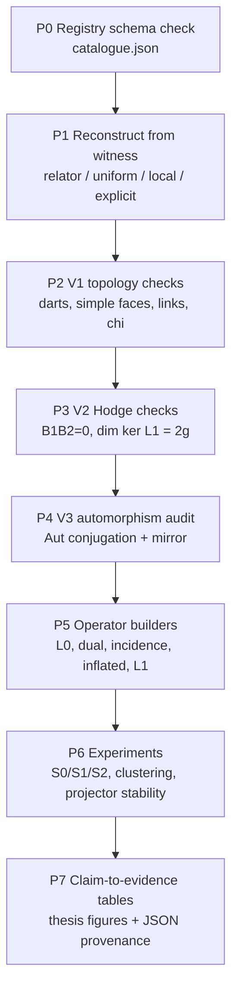

# Proof Plan 與驗證 Pipeline

本文件列出本專題實際要「證明」的命題，每條命題標記證明義務類型，並定義從 witness 到 thesis table 的完整 pipeline。與 [RESEARCH_PLAN.md](RESEARCH_PLAN.md) 的 16 週排程互補：那份文件回答「何時做」，本文件回答「要證什麼、怎麼證、用什麼檢查驗收」。

## 0. 證明義務的三種類型

每個 thesis claim 必須標記為以下其中一種，不得混用：

| 標記 | 意義 | 驗收方式 |
|---|---|---|
| **P** (paper proof) | 有限維、可在論文中完整書寫的數學證明 | 論文章節 + 引用 |
| **M** (machine-verified) | 對 registry 中每個實例逐一由程式檢查的有限命題 | `verify_examples.py` 全綠 + JSON report |
| **E** (empirical) | 只在實驗矩陣範圍內成立的條件式觀察 | 固定 seed、可重現 config、信賴區間 |

原則：P 型命題給出一般性；M 型命題保證 catalogue 無誤；E 型命題永遠不寫成定理。

## 1. 要證明的命題

### T1 — L0 face-blindness（P，核心且簡短）

**命題。** 固定 \((G,S)\)，\(S=S^{-1}\)。對任意兩個 face systems \(\mathcal F_1,\mathcal F_2\)（可為不同 genus），adjacency matrix \(A\)、\(L_0=kI-A\)、\(L_{\mathrm{norm}}\) 完全相同；因此任何只依賴 \(L_0\) 的 spectral clustering 輸出（在相同 tie-breaking 下）相同。

**證明策略。** 定義層次的證明：\(A\) 只是 \((G,S)\) 的函數，\(\mathcal F\) 不進入 \(B_1\) 的定義域。一頁內完成。真正要小心的是把「clustering 輸出相同」寫成對 deterministic pipeline 的敘述（重根時需固定 invariant-subspace 選取規則）。

**Machine check（M 補強）。** Pipeline 對每組 Set A/B matched pair 做 regression test：`assert np.array_equal(A(F1), A(F2))`。

### T2 — Hodge nullity 偵測 genus（P + M）

**命題。** 若 \((G,S,\mathcal F)\) 通過 V1（closed orientable surface cellulation，genus \(g\)），則
\[
B_1B_2=0,\qquad \dim\ker L_1=\dim\ker B_1\cap\ker B_2^\top=2g.
\]

**證明策略。** 離散 Hodge 分解（Eckmann）：\(C_1=\operatorname{im}B_1^\top\oplus\operatorname{im}B_2\oplus\mathcal H_1\)，\(\ker L_1=\mathcal H_1\cong H_1(\Sigma;\mathbb R)\)，closed orientable genus-\(g\) surface 的 \(\operatorname{rank}H_1=2g\)。這是已知定理；論文中的貢獻是（i）完整寫出 cellulation 版本的證明，（ii）對 25 個 witnesses 逐一機器驗證（已達成，25/25）。

**推論（T1+T2 的合體，本專題主要「定理級」貢獻）。** 存在 \((G,S,\mathcal F_1),(G,S,\mathcal F_2)\)，\(L_0\) 相同而 \(\operatorname{Spec}(L_1)\) 不同。證明 = T1 + registry 中任一 Set A pair（如 \(Q_8:g=1\) vs \(g=3\)）的機器驗證輸出。這是嚴格的 separation statement：**face-aware operator 嚴格強於 ordinary spectrum**。

### T3 — Validator soundness（P）

**命題。** 若 faces 滿足（a）exact oriented-dart partition、（b）simple boundaries、（c）每個 vertex link 是單一 cycle，則沿 faces 貼 2-cells 得到的空間是 closed orientable surface，且 \(g=(2-\chi)/2\)。

**證明策略。** Heffter–Edmonds–Ringel rotation-system 理論的標準論證：dart partition 給 2-complex；vertex link 單一 cycle ⟺ 每個頂點的 star 是 disk（排除 non-manifold points）；一致 orientation 由 oriented darts 給出。同時給反例：只有 dart partition、link 斷裂的 2-complex（README 已指出 \(Q_8\) 舊 relator witness 的教訓，正式寫成 non-example）。

**用途。** 這條讓 V1 checklist 不只是 heuristics，而是充分條件的機器化。

### T4 — 三種 construction 的完備性邊界（P）

**命題群。**
1. General local rotations 與固定 graph 的 orientable cellular embeddings 一一對應（Heffter–Edmonds，引用 + 重述證明）。
2. Uniform rotations 恰好對應 left-\(G\)-equivariant embeddings（Cayley maps）：\(\sigma\) 與所有 left translations 交換 ⟺ 每個頂點 cyclic order 相同。給出雙向證明。
3. Relator orbits 不完備：具體 witness——\(S_4\) 的 uniform genus-4 surface（\(6\times12\)）不在 Coxeter relator 生成範圍內，或 registry 中任一 explicit-rotation-only witness。

**用途。** 這組命題是 catalogue 標記欄位 `construction.type` 的數學正當性，防止「all embeddings」誤稱再次發生。

### T5 — A/B equivalence 的可判定程序（P + M，Week 4 的核心）

**命題。** 兩個 rotation systems \(\sigma_1,\sigma_2\) 給出等價 embedding ⟺ 存在 \(\varphi\in\operatorname{Aut}(\Gamma)\) 使 \(\varphi\sigma_1\varphi^{-1}=\sigma_2\) 或 \(\varphi\sigma_1^{-1}\varphi^{-1}=\sigma_2\)（mirror）。因此 A/B audit 是有限群作用下的 orbit membership 問題，可對 \(|\operatorname{Aut}(\Gamma)|\) 逐一檢查。

**證明策略。** 等價 embedding 的組合定義 + rotation system 的函子性；mirror 對應 orientation reversal。實作上：先算 \(\operatorname{Aut}(\Gamma)\)（小圖直接 backtracking 或 nauty-style canonical labeling），再做 conjugation test。

**交付。** 六個 pending A/B entries（\(Q_8\) g=2、\(\mathbb Z_4^2\) g=3、\(\mathbb Z_3^2\) mixed）升級為 V3，結論二選一：inequivalent（附 orbit 證書）或 equivalent（catalogue 合併並記錄 witness \(\varphi\)）。兩種結果都是合法成果。

### T6 — 小群 spectra 的閉式對照（P + M）

**命題。** 對 abelian 群（\(\mathbb Z_4^2,\mathbb Z_2^3,\mathbb Z_3^2\)）由 characters 給出 \(\operatorname{Spec}(A)\) 閉式；對 \(D_4,Q_8,D_6,D_8,S_3,A_4,S_4\) 由 irreducible representations（Babai 公式）給出。逐群驗證 `verify_examples.py` 的數值 spectrum 與閉式一致。

**用途。** 把「representation theory 決定 ordinary spectrum、但完全看不見 \(\mathcal F\)」寫實，同時是 Problem 3（Cay-DS）章節的計算基礎。

### T7 — Genus 與 bottleneck 的分離（E，明確不是定理）

**假設（不寫成命題）。** 在 connected-sum 家族中固定 genus 改變 neck width（及反向），\(\lambda_2(L_0)\) 主要追蹤 conductance，\(\operatorname{Spec}(L_1)\) 低頻部分主要追蹤 genus。外部 anchor 是 Kelner \(\lambda_2=O(g/n)\)——引用，不重證。

**驗收。** 只允許條件式敘述 +（Gate C）genus 與 neck width 未能獨立控制時放棄因果語言。每張圖附 config hash 與 seeds。

### 命題 × 證據對照表（thesis 骨架）

| Claim | 類型 | 論文位置 | 機器證據 |
|---|---|---|---|
| T1 blindness | P | Ch. 2 | Set A/B adjacency regression |
| T2 \(\dim\ker L_1=2g\) | P+M | Ch. 3 | 25/25 Hodge checks |
| T1+T2 separation | P+M | Ch. 3 末 | matched \(L_1\) spectra table |
| T3 validator soundness | P | Ch. 2 | non-example test case |
| T4 completeness 邊界 | P | Ch. 2 | construction.type 欄位 |
| T5 V3 audit | P+M | Ch. 4 | orbit certificates |
| T6 closed-form spectra | P+M | Ch. 5 | 閉式 vs 數值 diff = 0 |
| T7 genus vs neck | E | Ch. 6 | seeds + CI + configs |

## 2. Pipeline

### 各階段規格

| Stage | Input | Output | Acceptance | Script（現有 → 要建） |
|---|---|---|---|---|
| P0 | `catalogue.json` | schema 驗證 report | 每 entry 有 id/group/genus/profile/construction/verification | `verify_examples.py`（現有，補 schema 檢查） |
| P1 | construction witness | faces（oriented dart cycles） | witness 可重建、deterministic | `surface_systems.py`（現有） |
| P2 | faces | V1 pass/fail per entry | T3 的全部條件 | `validate_surface`（現有） |
| P3 | faces | \(B_1,B_2\)、nullity report | \(B_1B_2=0\)、\(\dim\ker L_1=2g\) | `hodge_checks`（現有；Week 5 移 sparse） |
| P4 | 同-profile pairs | equivalence certificates | 每對有 \(\varphi\) witness 或 exhaustion 證書 | **要建**：`automorphism_audit.py` |
| P5 | V2/V3 surfaces + \(\omega\) | operator matrices + rank table | 同 skeleton ⇒ 同 \(L_0\)（T1 regression） | **要建**：`operators.py` |
| P6 | operators + seeds | clustering labels、stability metrics | 每 stochastic setting ≥10 seeds；重根用 projectors | **要建**：`experiments.py` + configs |
| P7 | P6 raw tables | matched comparison tables | 每個 thesis claim 指向一個 test 或 table | **要建**：`report.py` |

Pipeline 原則：每個 stage 輸出 machine-readable JSON 並附 upstream hash，thesis 中任何數字都能回溯到某次 P0–P7 run。S2 combinatorial asymmetry 的每次修改必須重進 P2/P3，不得跳關。

## 3. 證明工作的排程對應

| 週 | 證明工作 | 對應 |
|---:|---|---|
| 1–2 | T1、T3 寫成正式證明；T3 non-example 進 test suite | P0–P2 |
| 3 | T4.2（uniform ⟺ equivariant）證明；cubic exhaustive enumerator 驗證 T4.1 計數 | P1 |
| 4 | T5 程序 + 六個 A/B audits → V3 | P4（Gate A） |
| 5 | T2 證明定稿；sparse Hodge 重跑 25/25 | P3 |
| 6–9 | T6 閉式推導與數值對照；T1+T2 separation table | P5、P6（Gate B） |
| 10–12 | T7 實驗（只產生 E 型敘述） | P6（Gate C） |
| 13–16 | 對照表 §1.9 全部填滿；每格連到 test/table | P7 |

## 4. 失敗模式與對策

- T5 audit 發現某 A/B pair 其實 equivalent：合併 entries、更新 §6 counts——這是修正不是損失，明寫入 thesis。
- \(\operatorname{Aut}(\Gamma)\) 太大（如 \(S_4\) cube-like skeletons）：先 canonical labeling 降到 orbit representatives，再 conjugation test。
- T7 的 genus/neck 無法獨立控制：依 Gate C 降級為描述性章節，separation 主貢獻仍由 T1+T2 承擔。
- 重根 eigenspaces 導致 clustering 不穩定：一律報 projector distance 與 principal angles，不報單條 eigenvector 差異。

最低可辯護版本 = T1 + T2 + T3 + T5（P/M 型全部完成），T6 部分完成，T7 至少一組 controlled sweep。這與 RESEARCH_PLAN §12 的 minimum viable thesis 一致。
