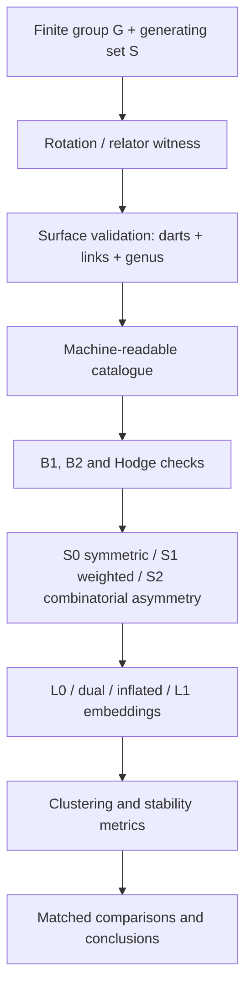

# 高虧格 Cayley Surfaces、非對稱性與 Spectral Clustering

本專案從有限群、Cayley graph 與 rotation systems 出發，建立可驗證的 closed orientable surface cellulations，再研究普通 graph spectrum、Hodge spectrum 與 spectral clustering 在 topology、face system 和 symmetry 被改變時的差異。

詳細資料：

- [RESEARCH_PLAN.md](RESEARCH_PLAN.md)：16 週研究計畫與 matched experiments。
- [THREE_REAL_PROBLEMS.md](THREE_REAL_PROBLEMS.md)：三個有正式文獻依據的外部數學問題。
- [../data/surfaces/catalogue.json](../data/surfaces/catalogue.json)：所有 surface witnesses 的唯一 machine-readable registry。
- [../handbook/notes.html](../handbook/notes.html)：定義、定理與例子筆記。
- [../handbook/roadmap.html](../handbook/roadmap.html)：16 週 roadmap 的網頁檢視版。

## 目前狀態

截至 2026-07-16：

- 10 個有限群／固定生成集；
- 25 個 surface witnesses；
- genus \(0,1,2,3,4\)；
- 25/25 通過 connectivity、inverse closure、simple faces、exact dart partition、single-cycle vertex links、Euler characteristic 與 orientable genus；
- 25/25 通過 \(B_1B_2=0\) 與
  \[
  \dim\ker L_1=2g;
  \]
- 三組同 face profile 的 A/B candidates 尚未 quotient by graph automorphisms；
- clustering、asymmetry sweep 與完整 automorphism analysis 尚未完成。

執行完整驗證：

```powershell
python handbook/verify_examples.py
```

輸出 machine-readable report：

```powershell
python handbook/verify_examples.py --json
```

## 最重要的數學區分

研究資料單位不是群 \(G\)，而是

\[
X=(G,S,\mathcal F,c,\omega).
\]

- \(G\)：有限群與頂點標籤；
- \(S\)：生成集，決定 Cayley skeleton \(\Gamma=\operatorname{Cay}(G,S)\)；
- \(\mathcal F\)：oriented face system，決定 surface cellulation；
- \(c\)：可重建 \(\mathcal F\) 的 construction witness；
- \(\omega\)：可選的正 edge weights，用來控制 symmetry breaking；未指定時為全 1。

因此：

1. 改變 \(S\) 會改變 graph、diameter 與 spectrum；
2. 固定 \((G,S)\) 而改變 \(\mathcal F\)，普通 adjacency matrix 與 \(L_0\) 完全不變；
3. genus 是 \((G,S,\mathcal F)\) 的性質，不應自動稱為 abstract graph 的 minimum genus；
4. \(2g\) 個 harmonic 1-directions 是 topology signal，不是 \(g\) 個 vertex clusters。

## Face systems 的標準模型

固定 inverse-closed 生成集 \(S\)。有向 darts 為

\[
D=G\times S.
\]

Edge reversal 是

\[
\alpha(g,s)=(gs,s^{-1}).
\]

在每個頂點指定 incident darts 的 cyclic order，得到 vertex rotation permutation \(\sigma\)。Faces 是

\[
\phi=\sigma\alpha
\]

的 cycles。這是固定 Cayley graph 的 orientable cellular embeddings 的標準完備語言。

本專案明確區分三種搜尋範圍：

| 方法 | 搜尋範圍 | 是否完備 |
|---|---|---|
| Relator orbits | 從指定 closed words 建 face orbits | 否，只是 candidate generator |
| Uniform rotation | 所有頂點使用同一 cyclic generator order | 只對 Cayley-equivariant subclass 完備 |
| General local rotation | 每個頂點獨立選 cyclic order | 對固定 graph 的 orientable rotation systems 完備 |

若 graph 為 \(d\)-regular、頂點數為 \(n\)，未 quotient 前的 general search size 是

\[
((d-1)!)^n.
\]

所以 cubic graph 是 \(2^n\)，degree-4 graph 是 \(6^n\)。這是本專案需要 automorphism quotient、canonical labeling 與 staged search 的原因。

舊版 `code/draw.py` 中的 `all_valid_embeddings` 已更名為 `uniform_rotation_embeddings`；舊名稱會誤導為完整枚舉。完整核心定義在 `code/surface_systems.py`。

## Surface validator

每個 registry entry 都必須通過：

1. \(S=S^{-1}\) 且 Cayley skeleton connected；
2. 每個 oriented dart 恰好出現在一個 face；
3. 每個 face boundary 是 simple cycle；
4. 每個 vertex link 是一個 cycle；
5. \(\chi=V-E+F=2-2g\)；
6. 建立 cellular boundary matrices
   \[
   B_1:C_1\to C_0,\qquad B_2:C_2\to C_1;
   \]
7. 驗證
   \[
   B_1B_2=0;
   \]
8. 驗證
   \[
   L_1=B_1^\top B_1+B_2B_2^\top,qquad \dim\ker L_1=2g.
   \]

只有 dart condition 不足以證明得到 surface；vertex link disconnected 時可能只是 non-manifold 2-complex。

## 目前 finite-group catalogue

| 群與固定生成集 | topology-verified surfaces |
|---|---|
| \(D_4\), \(\{r,r^{-1},s\}\) | \(g=0:6\times4\); \(g=1:4\times6\); \(g=1:2\times4+2\times8\) |
| \(Q_8\), \(\{\pm i,\pm j\}\) | \(g=1:8\times4\); two \(g=2:4\times4+2\times8\); \(g=3:4\times8\) |
| \(D_6\), \(\{r,r^{-1},s\}\) | \(g=0,1,2\) local-rotation witnesses |
| \(\mathbb Z_4^2\), standard four generators | \(g=1:16\times4\); two \(g=3:8\times4+4\times8\) |
| \(\mathbb Z_2^3\), standard basis | \(g=0:6\times4\); \(g=1:4\times6\) |
| \(\mathbb Z_3^2\), standard four generators | \(g=1:9\times4\); two \(g=1:6\times3+3\times6\) |
| \(S_3\) | \(g=0:2\times3+3\times4\) |
| \(A_4\) | \(g=0:4\times3+4\times6\) |
| \(D_8\) | \(g=0,1,3\) local-rotation witnesses |
| \(S_4\), adjacent transpositions | Coxeter sphere \(g=0:6\times4+8\times6\); uniform \(g=4:6\times12\) |

`A/B` candidates 只有在通過 automorphism quotient 後才能宣稱是 inequivalent embeddings。相同 genus 和相同 face profile 並不足以證明不等價。

## Spectral operators

普通 vertex operators：

\[
L_0=B_1B_1^\top.
\]

對 \(k\)-regular Cayley graph，若 \(A\) 是 adjacency matrix，則

\[
L_0=kI-A,
\qquad
L_{\mathrm{norm}}=I-\frac1kA.
\]

Face-sensitive operators：

\[
L_1=B_1^\top B_1+B_2B_2^\top,
\qquad
L_2=B_2^\top B_2.
\]

後續還要比較：

- classical dual graph；
- vertex-face incidence graph；
- face-inflated graph；
- gradient、curl、harmonic subspaces；
- directed／magnetic operator，處理 \(S\neq S^{-1}\) 的非對稱 Cayley digraphs。

## 實驗 Pipeline



Matched experiments：

1. same skeleton, different genus；
2. same skeleton and genus, different face systems；
3. same abstract graph, different group actions；
4. same surface, increasing weighted asymmetry；
5. same genus, different bottleneck width。

## 三個外部數學問題

本專題與下列正式問題連結，細節與來源見 [THREE_REAL_PROBLEMS.md](THREE_REAL_PROBLEMS.md)：

1. Graph genus 與 cellular embedding enumeration；
2. bounded-genus graphs 的 spectral partitioning；
3. Cayley-DS 與 non-isomorphic cospectral Cayley graphs。

主線放在前兩題；第三題說明 ordinary spectrum 為什麼可能不足。

## Repository 結構

```text
README/
  README.md                 # 專案入口與目前真實狀態
  RESEARCH_PLAN.md          # 16 週計畫與實驗設計
  THREE_REAL_PROBLEMS.md    # 三個外部數學問題與正式來源
code/
  surface_systems.py        # 群、rotation systems、relators、完整 validator
  draw.py                   # legacy Plotly visualization helper
data/surfaces/
  catalogue.json            # 25 個 surface witnesses 的唯一 registry
handbook/
  verify_examples.py        # registry + topology + Hodge + spectrum 驗證
  notes.html                # 完整學習筆記
  roadmap.html              # 16 週路線圖的網頁檢視版
  slides.html               # 簡報
references/                 # 原始文獻，不直接修改
progress/                   # 歷史進度 PDF
thesis/                     # 歷史論文／簡報 PDF
```

PDF 是歷史快照，可能含已被 registry 修正的舊標籤；最新可計算結論以 `catalogue.json` 與 `verify_examples.py` 為準。

## 執行環境

基本驗證只需要 Python 與 NumPy：

```powershell
python -m pip install numpy
python handbook/verify_examples.py
```

舊版互動圖另外需要 Plotly：

```powershell
python -m pip install plotly
python code/draw.py
```

## 下一個可驗收里程碑

1. 對 Q8 genus-2、\(\mathbb Z_4^2\) genus-3、\(\mathbb Z_3^2\) mixed A/B 做 automorphism quotient；
2. 將 `SurfaceComplex`、\(B_1,B_2\) 與 sparse Hodge operators 移到正式 library API；
3. 完成 \(L_0\)、dual、inflated、\(L_1\) clustering baselines；
4. 加入固定 seed 的 positive-weight asymmetry sweep；
5. 輸出第一張 matched comparison table，而不是只增加新的圖。

## 研究原則

- 每個 topology claim 必須有 dart、vertex-link 與 Hodge checks。
- 不把 uniform rotation search 稱為 all embeddings。
- 不把選定 cellulation 的 genus 稱為 abstract graph minimum genus。
- 不把 harmonic dimension \(2g\) 直接解讀成 cluster count。
- 對重根比較 invariant subspaces／spectral projectors，不逐條比較 eigenvectors。
- 只有通過 machine-readable verification 的資料才能進入 thesis tables。
