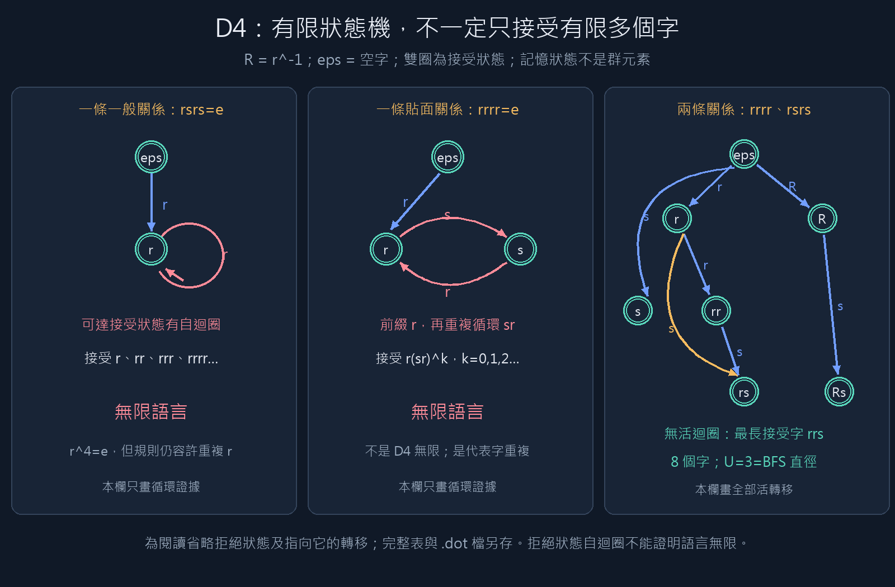

# D4：從帶標籤關係到有限狀態自動機

本次交付：2026-11-03。使用既有兩輪 D4 球面案例（seed=0），不重新選關係、不修改歷史結果。

- [計算總表](summary.md)
- [逐步走讀：完整轉移表、循環與最長字](walkthrough.md)
- [三組自動機的教學圖](automata-comparison.png)
- [最新結果目錄與雜湊](latest-run.json)



## 你先理解這三個不同對象

1. **D4 群：**8 個元素，固定生成元 r、r^-1、s 的直徑為 3。
2. **操作字：**r、rr、rrr……有無限多個，很多表示同一元素。
3. **自動機狀態：**記錄近期字尾，以判斷是否命中禁止子字；不是群元素。

例如完整組的記憶狀態 `rs` 可以在讀完 `rs` 或 `rrs` 後到達，但這兩個字到達不同群元素。自動機可以忘記對規則比對無關的前段，不代表它無損保存群狀態。

## 1．自動機接受什麼？

把每條合法 shortlex 規則的左側當成禁止子字。以貼面單關係組為例，`rrr→r^-1` 意味著任何包含 `rrr` 的字都拒絕；共同的 `ss→e` 也會拒絕包含 `ss` 的字。

**接受 = 這套規則無法再改寫；不是預先保證最短。** 每個非拒絕狀態都是接受狀態。

狀態記憶是「目前字尾中，仍可能接成某個禁止子字的最長前綴」。這讓每次讀新字母只需查一次轉移表。遇到禁止子字後進入永久拒絕狀態；不能因後面多讀一個 s 就恢復接受。

建構保留可達的記憶狀態，未做 DFA 最小化。每個規則先在全部 8 個群起點上檢查終點相同及嚴格 shortlex 下降。

## 2．只選一般短關係 rsrs=e：為什麼無限？

讀入 r 後到記憶 r，再讀 r 仍停在 r。這是可達接受狀態上的自迴圈：

```text
eps --r--> [r] --r--> [r] --r--> [r] ...
```

因此接受 r、rr、rrr、rrrr 等任意長的字。`r^4=e` 在群裡成立，但這組規則沒有禁止長串 r，所以同一元素仍有無限多個接受代表。

保存證書：前綴 r、循環 r，以及完整狀態編號路徑。拒絕狀態的自迴圈不算證據。

## 3．只選貼面關係 rrrr=e：限制 rrr 仍不夠

這次 rrr 被拒絕，但讀 r 後仍能反覆讀 sr：

```text
eps --r--> [r] --s--> [s] --r--> [r] ...
```

接受字為 `r(sr)^k`，k 可任意大。第一個非最短例子是 rsr，它表示 s，但沒有命中此組規則的左側。

循環 sr 的群階數為 2，所以 srsr=e。從記憶 r 出發，不斷插入 srsr，會得到任意長、仍表示同一群元素的接受字。有限群與無限語言完全不矛盾。

## 4．既有完整預算組：語言恰好剩 8 個字

完整預算雖允許最多 8 條 relators，這個案例實際選到兩條：rrrr、rsrs。一般與貼面兩組的規則完全相同（18 條），只差來源列表順序。

兩個 DFA 都沒有可達的活迴圈。接受語言恰為：

\[
\{\varepsilon,r,r^{-1},s,rr,rs,r^{-1}s,rrs\}.
\]

最長字 rrs，長度 U=3；各長度字數為 1、3、3、1。本例完整重播 8 個字，確認終點恰覆蓋 D4 的全部元素，各字也都符合 BFS 最短距離。

這支持「這兩條關係合起來足以消除本例的無限重複代表」，**不支持「貼面來源優於一般短關係」**，因為完整組兩邊的規則相同。

## 5．如何證明有限，而非只是找不到長字？

自動機具有有限個狀態，不代表接受語言有限。判準是可達的接受狀態圖有沒有循環。本實驗中所有非拒絕狀態接受，因此：

- **無限證書：**可達前綴＋非空活迴圈；循環可反覆走。
- **有限證書：**全部活狀態的拓撲順序；每條活轉移都往後走，因此路徑長度有界。

在 DAG 上反向動態規劃計算：

\[
L(q)=\max\bigl(\{0\}\cup\{1+L(q'):q\to q'\text{ 是活轉移}\}\bigr).
\]

由起點的 L 得到最長字長度。字數也以 `count(q)=1+sum(count(q'))` 計算（不同字母通往同一狀態仍分別計數）。最長長度的計算本身沒有使用 BFS 直徑；BFS 是另外的比較基準。

此例每組另將長度 0..8 的全部 9841 個字，與原剪枝器逐字比較；六組合計 59046 個比較。這是回歸檢查，不取代全域的轉移不變量、循環或拓撲證書。

## 6．為什麼 U 是距離上界？

對任意元素 g，取字典序最小的最短字 w。若 w 含規則左側，合法 shortlex 下降替換會得到更短或同長更小的代表，矛盾。所以 w 必被接受。

因此若所有接受字長度至多 U，每個元素都能在 U 步內到達，直徑至多 U。**這個上界不需要先證明規則合流。**

此例另外有 BFS 下界 3，與 U=3 相合，故可確認直徑為 3。若有限語言還接受較長冗餘字，U 可能只是鬆的上界；若語言無限，也不能推出群直徑無限。

## 7．如何驗證我們沒有相信錯誤的程式？

`verify_relation_automata.py` 不匯入 DFA 建構器或有限性判定器，直接檢查：

- 原始案例與規則來源雜湊、規則在每個群起點的合法性。
- 所有狀態及轉移是否滿足最長字尾不變量，拒絕狀態是否永久吸收。
- 活狀態可達性；直接子字掃描的逐字比較。
- 無限證書的可達路徑、非空迴圈及群乘積。
- 有限證書的每條邊拓撲順序、最長路徑與字數遞迴式。
- 所有有限接受字與群端點、BFS 的比較。

仍共用既有群／曲面來源檢查器，不稱為完全獨立實作或 Lean 證明。這是固定小案例的正確性實驗，沒有證明大型群會有小自動機，也沒有測得搜尋加速。

## 操作與輸出

從 repository 根目錄：

```powershell
# 只需標準 Python；建立新的結果目錄並自動驗證證書
python cayley-thesis/experiments/relation_automata.py

# 驗證保存的一輪（使用程式印出的目錄）
python cayley-thesis/experiments/verify_relation_automata.py <結果目錄>

# 8 項測試，含錯誤轉移、假循環與錯誤最長長度的負面對照
python -m unittest discover -s cayley-thesis/experiments -p test_relation_automata.py -v

# 可選：使用既有環境的 Pillow 重畫教學圖
cayley-thesis/manim-scenes/.venv/Scripts/python.exe cayley-thesis/experiments/draw_relation_automata.py
```

或執行 `& ./cayley-thesis/reports/d4-relation-automata/run-experiment.ps1` 一鍵運行、測試與畫圖。核心實驗和驗證器不需要 NumPy、Graphviz、GAP、Manim 或網路。

每輪在 `experiments/results/d4-automata/<UTC時間>/` 保存：

- 每組 `.json`：規則、完整 DFA、有限／循環證書、BFS 比較。
- 每組 `.dot`：含拒絕狀態與全部轉移的 Graphviz 原始圖；不要求已安裝 Graphviz。
- `results.json`、`verification.json`、`summary.md`、`walkthrough.md`。
- 執行失敗時的 `failure.txt`；完成的先前組別仍保留。

報告資料夾保存最新閱讀副本與指標；過去各輪不覆蓋。這次只比較 D4 球面 witness 的 seed=0，沒有假裝完成所有群／面系統的自動機分析。

## 向老師用 3 分鐘說明

1. 有限群有無限多操作字；自動機記憶的是字尾，不是群元素。
2. 一條 rsrs 關係仍允許 r 的自迴圈；一條 rrrr 關係仍允許 sr 循環。
3. 兩條合用後，活圖無迴圈，最長字 rrs 長 3。
4. 用合法 shortlex 規則證明 U 是上界，再用 BFS 下界確認相等。
5. 下一步才研究更大直徑小群、不同規則選擇與自動機成本，不預設面資訊能帶來突破。
