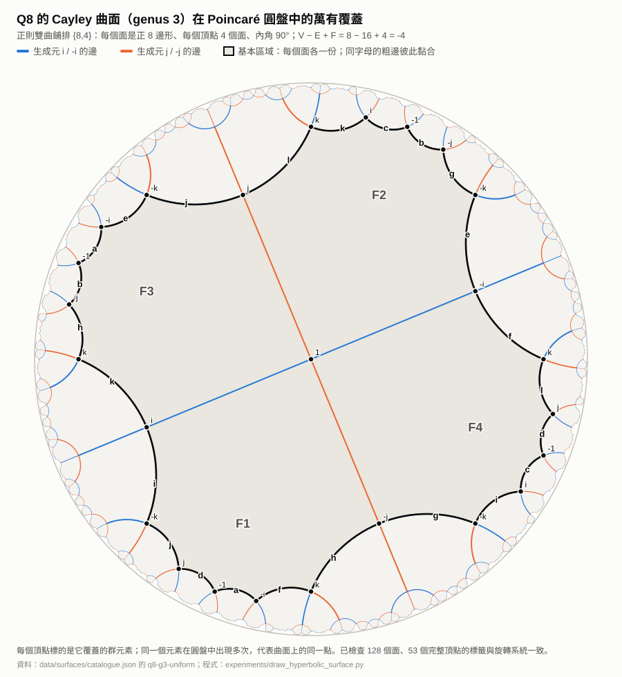

# 雙曲畫法：Q8 的 genus 3 Cayley 曲面

由 [`experiments/draw_hyperbolic_surface.py`](../../experiments/draw_hyperbolic_surface.py) 從 `data/surfaces/catalogue.json` 的 `q8-g3-uniform` 產生（只讀目錄，不改任何正式結果）。畫法與 Klein quartic 的標準圖相同：在 Poincaré 圓盤畫出曲面的萬有覆蓋，再標出基本區域與黏合規則。

## 為什麼是雙曲幾何

- 曲面：Q8，生成元 i, −i, j, −j，每個頂點使用相同的循環順序 (i, j, −i, −j)。
- V − E + F = 8 − 16 + 4 = −4，所以 genus g = 3。
- 4 個面都是 8 邊形，每個頂點 4 個面：{p,k} = {8,4}，1/8 + 1/4 < 1/2，因此只能用雙曲幾何讓所有面都是正多邊形。
- 每個正八邊形內角 90°，面積 (p − 2)π − p·α = 6π − 4π = 2π；4 個面共 8π = −2πχ，符合 Gauss–Bonnet。

## 怎麼讀這張圖

- **頂點標籤**：每個頂點標的是它覆蓋的 Q8 元素。同一個元素在圓盤中出現很多次，代表曲面上的同一點。
- **邊的顏色**：藍色是 ±i 的邊，橘色是 ±j 的邊。因為每個頂點度數為 4，正對面的兩條邊連成一整條測地線。
- **灰色區域**：基本區域，F1–F4 各一份，剛好圍在元素 1 周圍。這是因為每個面恰好經過全部 8 個元素一次，所以每個頂點周圍都是四個不同的面。
- **粗黑邊與字母**：基本區域的邊界。同一個字母的兩條粗邊在曲面上是同一條邊，把它們黏起來就回到 genus 3 曲面。共 12 對，加上內部 4 條，等於曲面的 16 條邊。

## 與 genus 的關係

圓盤中無限延伸的圖，是「只用面的關係式」得到的無限群的 Cayley 圖。字母標出的黏合規則，就是把它捲成有限的 genus 3 曲面所需要的額外關係。這和 Klein quartic 一樣：(2,3,7) 三角群鋪滿雙曲平面，再除以一個 genus 3 曲面群，得到 PSL(2,7) 的曲面。

## 檢查

程式會斷言：每個鋪排頂點只得到一個標籤；每個完整頂點周圍的鄰居恰好是四個生成元，而且循環順序符合旋轉系統（或其鏡像）。本圖檢查了 128 個面、53 個完整頂點，全部一致。

這是理解與展示用的圖，不改變任何距離，也不是解題演算法的一部分。
