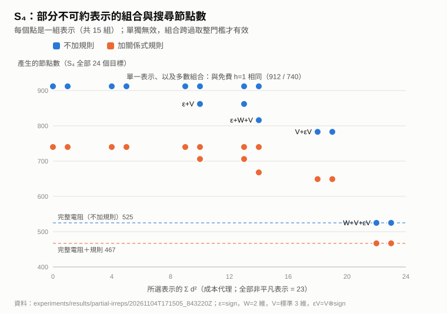
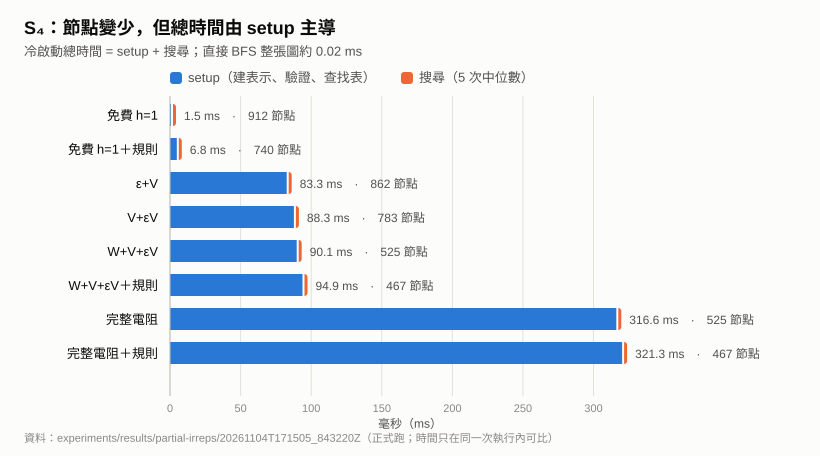

# 部分不可約表示下界：實作、比較與四角色評估

日期：2026-11-05（臺北）。目標：利用群結構改善最優搜尋，而不是僅重建光譜。

## 實作範圍與公式

此次選專案已有的 D4（階8）、S3（階6）、S4（階24），因其所有不可約表示可在有理數矩陣中完整、精確實作。不是全部十個catalogue群，也不是真正魔方群。總計38個單位元到目標查詢。

對每個非平凡不可約表示rho，構造 K=kI-sum_s rho(s)。有理基底未必正交，所以保留正定不變Gram矩陣H，使用 X^dagger=H^-1 X^T H。定義：

R_rho(g)=d_rho/|G| trace[(I-rho(g)) K^-1 (I-rho(g))^dagger]。

每項非負，所有非平凡表示相加精確等於完整有效電阻。選T個表示，R_T=sum_T R_rho，滿足0≤R_T≤R_eff≤d。搜尋使用 h_T(g,t)=max(1[g!=t],ceil(R_T(g^-1 t)))。加上免費下界，避免非faithful表示的kernel讓新方法反而弱於baseline。

Fraction精確求逆、trace與取整，不以浮點容差判admissibility。K的H-selfadjoint及KK^-1=I均核對。不同表示的multiplicity以d_rho係數納入，不能漏掉。

部分電阻不假設一致性，搜尋不使用全域closed/visited剪枝。本輪所有列舉狀態剛好沒有一致性違例，但不據此推論一般定理。

## 實作檔案

- experiments/small_irreps.py：D4/S3/S4完整表示、Gram、乘法及角色完整性驗證。
- experiments/partial_irrep_search.py：表示貢獻、所有子集、相同IDA*、既有關係剪枝、計時與選擇實驗。
- experiments/test_partial_irreps.py：獨立數學測試。
- experiments/verify_partial_irreps.py：唯讀重播保存結果。

S4的非平凡表示：sign（1維）、standard_3d（3維）、sign_twist_3d（3維）、matching_quotient_2d（2維）。最後一者來自S4作用在四點的三種完美配對上，再取S3的標準表示。

## 比較協定

正式資料：experiments/results/partial-irreps/20261104T171505_843220Z/results.json及summary.md。先前時間戳是開發檢查輪，保留但不作正式引用。

1. D4所有15個非空子集、S3所有3個、S4所有15個；另加免費h=1及完整電阻。
2. 每種方法分無關係剪枝/有關係剪枝，共78個arm、1148個不同arm×target；每個搜尋重複5次，保存原始時間，以整批query時間總和的中位數比較。
3. 同一生成元順序、單位操作成本、相同相鄰逆操作消去、無visited table；不拿BFS真值作深度限制。
4. 每群固定取catalogue首個面系統的全部canonical面關係，使用既有rules_for與verify_rules。來源分別是d4-g0-squares、s3-g0-uniform、s4-g0-coxeter；額外規則數15/14/19（逆消去由搜尋器共同處理）。未依BFS距離選面或關係。
5. 偶數target索引為train，奇數為heldout。每個d²預算內僅按train生成數選subset，以d²及名稱打破同分，再報heldout；另外保留不經訓練的dimension/name前綴控制。
6. heldout仍在同一群內，不是新群或獨立資料集。所有目標共同的表示/圖結構無法與target索引分割等同跨群泛化。

## 主要結果：所有目標生成節點總數



|群/表示|d²成本proxy|無關係剪枝|有關係剪枝|
|---|---:|---:|---:|
|D4：免費h=1|0|42|42|
|D4：任何表示子集/完整電阻|1–7|42|42|
|S3：免費h=1|0|21|21|
|S3：任何表示子集/完整電阻|1–5|21|21|
|S4：免費h=1|0|912|740|
|S4：任意單個表示|1/4/9|912|740|
|S4：sign + standard3d|10|862|706|
|S4：sign + standard3d + quotient2d|14|816|668|
|S4：standard3d + sign_twist3d|18|783|649|
|S4：三個高維表示（無sign）|22|525|467|
|S4：全部非平凡表示|23|525|467|
|S4：完整電阻直接電路求解|不適用|525|467|

S4最強組合相對免費無剪枝為912→467，少48.8%；相對已有關係剪枝為740→467，少36.9%。兩個分母不同，不混用。這是節點差，不是時間加速。

單個表示的實數貢獻都不足以讓整數h超過免費baseline；若先按單項效果丟掉它們，就會錯過組合跨越取整門檻的效益。

三個高維表示的raw partial resistance與full在12/24狀態不同，但取ceil後24/24相同，因此保存的是此例的整數heuristic與搜尋表現，不是恢復完整電阻。22相對23只少4.35%的d² proxy，並非大幅壓縮。

## 以train選定後的S4 heldout

|預算/選定表示|無剪枝heldout|有剪枝heldout|
|---|---:|---:|
|免費h=1|591|467|
|10：sign+standard3d|560|446|
|14：sign+standard3d+quotient2d|529|419|
|18：兩個3d|512|412|
|22：三高維|344|298|

訓練選擇所得改善在同群留出目標上存在。D4/S3沒有增益時，正確部署選擇應是免費h=1；程式train_selected只比較非空subset，不能把它在無增益時挑中的表示說成值得保留。

## 成本：目前沒有端到端勝出



圖由 `experiments/draw_bound_figures.py` 從正式結果唯讀產生。

S4正式輪、單位ms；預處理單次實測，搜尋為五次批次的中位數：

|方法|關係剪枝|預處理|搜尋|合計|
|---|---|---:|---:|---:|
|免費h=1|無|0.681|0.772|1.453|
|免費h=1|有|4.790|1.967|6.757|
|sign+standard3d|無|82.686|0.650|83.336|
|兩個3d|無|87.761|0.584|88.345|
|三高維|無|89.729|0.396|90.125|
|三高維|有|93.838|1.041|94.879|
|完整電阻直接解|無|316.149|0.403|316.552|
|完整電阻直接解|有|320.259|1.025|321.283|

重要成本約定：

- 表示庫factory會建全表並內建完整驗證；其全額成本計入每個subset。這不是只建選中表示的精簡實作。
- 之後只計所選表示的K/Gram求逆、全元素貢獻表、部分和、群差值查表、整數heuristic表。各步原始時間保存在JSON。
- 有關係剪枝者計入面建構、規則建構與逐起點驗證。
- 無啟發式的對照實際用免費target判等callback，不建heuristic表；其他方法使用V²預算表。V²是本次查詢實驗便利，不是群大小的壓縮。
- 預處理之外另有第二次冗餘表示審核、BFS真值、枚舉所有候選/訓練選擇、獨立驗證及保存成本；它們是整個實驗的額外成本，不能隱藏成一次選擇免費。experiment_seconds含整個run_group過程，序列化時間未納入。
- 搜尋時間只加IDA內部計時，不包含用BFS答案核對、重播操作字的assertions；另存batch wall time。
- 比直接電路預處理便宜，不代表優於最佳電阻求解器：原電路基準使用Fraction對每個端點重複消去，未用最優稀疏分解。
- S4 BFS真值本身約0.020ms；這些已完整建圖的小群直接BFS更適合。微秒計時不能解讀成穩定倍數。
- d²不是RAM實測；未量峰值記憶體。保存所有元素表示與全heuristic表的本實作不適合直接擴展魔方。

## 四角色評估

### 支持者

部分表示的安全下界確實可實作，且與shortlex剪枝可共存。S4中存在組合互補效應；10/14/18/22四個預算點形成有意義的節點成本曲線。三高維可省掉一維sign而保留此例完整電阻的整數效果。

### 反對者

D4/S3完全沒有額外訊號；S4任何單項也無效。最強表示集合只省極少d²，尚無大型群壓縮證據。預處理成本讓所有新增方法在本輪端到端輸給免費baseline；既有規則雖減節點，線性掃描成本也讓時間更高。

### 批判思考者

應保留10預算作低成本候選、18作中間候選、22作高強度對照；14可作互補性研究點。13預算的standard3d+quotient2d與10同樣節點，19預算的sign+兩3d與18同樣節點，因此在此節點/維度指標下不優先。這不是以維度保證所有實機時間支配。

不要把S4的某個表示名稱直接轉成魔方不可約表示。對魔方真正需要的是能由編碼直接低成本計算rho(g)、僅存生成元矩陣/小block，而非枚舉所有狀態。本次只能支持後續選表示實驗，不能宣稱已改善魔方solver。

### 驗證者

每個表示逐元素對乘法、Gram不變、角色內積與sum d²=N均精確驗證。所有subset貢獻非負、低於完整電阻/距離；全表示總和逐點等於獨立電路解。全部搜尋字合法且最優、計數可重現，既有規則保端點與shortlex下降。

測試與獨立重播能支持有限資料正確性，不證一般泛化、算法漸近改進或微秒計時顯著性。

正式run由獨立唯讀verifier核對PASS，覆蓋3群78arms與1148個arm×target。檢查器不匯入主runner、表示實作或原電路求解器，而自行重算Fraction矩陣逆、Gram貢獻與接地電阻；共享既有群/轉移核心，並非完全獨立的群定義。全套94項測試通過。

## 重跑

```powershell
$env:PYTHONDONTWRITEBYTECODE='1'
python cayley-thesis/experiments/partial_irrep_search.py --repeats 5
python cayley-thesis/experiments/verify_partial_irreps.py cayley-thesis/experiments/results/partial-irreps/20261104T171505_843220Z
python -m unittest discover -s cayley-thesis/experiments -p 'test_*.py'
```

每次runner建立新的UTC時間戳資料夾，與臺北日期可能差一天。輸出保存catalogue、核心程式與表示程式SHA-256；verification CLI只讀取、輸出PASS，不改結果。
