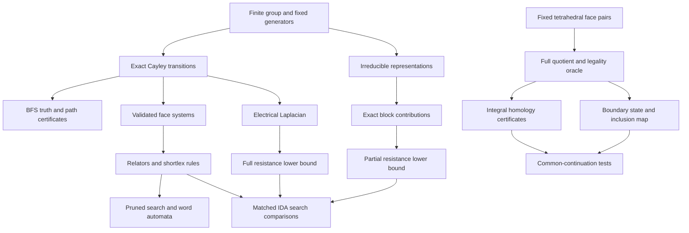

# Research Handoff: Cayley Structures, Topological States, Electrical Energy, and Partial Irreducible Representations

**Snapshot:** 5 November 2026, Asia/Taipei.  
**Repository:** `C:\Users\user\Documents\GitHub\Graduation-Project`.  
**Main project directory:** `cayley-thesis/`.

This document consolidates the current conversation and the available project records covering the recent research period, approximately 30 October–5 November 2026. Earlier October proposals are included as background and explicitly distinguished from implemented work. It is not a reconstruction of inaccessible conversations or a claim that all older repository assets were created this week.

Read this file first in a new conversation. For a shorter transferable prompt, use [the new-conversation starter](new-conversation-starter-2026-11-05.md). Paths below are relative to this file unless shown as repository-relative code paths. Timestamped result directories use UTC; a directory beginning `20261104T17...Z` belongs to 5 November in Taipei.

The [machine-readable manifest](research-handoff-2026-11-05.manifest.json) records checked paths, document/result hashes, formal-run counts, and the source-provenance comparison. Its documentation audit does not claim a new execution of the test suite.

## 1. Research objective and present verdict

The user's current objective is to **use the algebraic structure of the Rubik's Cube group to improve solving algorithms**, with small finite groups as controlled prototypes. Exact optimal solutions, useful distance lower bounds, sound pruning, and eventually diameter bounds are relevant outcomes. Determining the exact diameter of a large cube group remains a long-term ambition, not an achieved result or a promised next deliverable.

The original conceptual route was

\[
\text{group}\longrightarrow\text{Cayley graph}\longrightarrow
\text{cycles/faces}\longrightarrow\text{topological or geometric representation}
\longrightarrow\text{algorithmic information}.
\]

The important unresolved arrow is the last one: a representation must preserve or provably bound the particular quantity needed by the algorithm. A higher-dimensional drawing, a low-genus surface, or a low-energy state alone does not establish a shortest-word bound.

The current evidence supports three finite research achievements:

1. Sound relation-based word pruning and finite-language diameter certificates on selected small groups.
2. A topology-state workflow that finds information-loss witnesses, enriches the interface with an inclusion map, and predicts first homology in a restricted family.
3. Exact electrical and partial-representation lower bounds, together with controlled optimal-search comparisons.

**Present algorithmic verdict:** selected representation combinations reduce search nodes in the specified \(S_4\) experiment, but every added method loses to the free baseline in cold end-to-end time in the current implementation. No actual Rubik's Cube solver, asymptotic improvement, or new cube diameter bound has been established.

## 2. Chronology of ideas, with status

| Idea or question | Motivation | Current status |
|---|---|---|
| Group → graph → cycle tiling → topology | Expose structure hidden in a huge state space | Several finite constructions implemented; no general distance-preservation theorem |
| Classify what is preserved by changing equivalence relations | Separate group, graph, map, surface, and manifold information | Definitions and finite examples available; full proposed embedding classification not established |
| Fixed graph, different face systems | Test information invisible to ordinary adjacency spectra | Catalogue and matched examples available |
| Fixed tetrahedral face-pairing graph, varying vertex bijections | Turn topology questions into exact finite experiments | One- and two-tetrahedron families implemented |
| Compress gluing histories into a boundary state | Enable future dynamic programming | Basic state has explicit homology counterexamples; enhanced state only partly supported |
| PackingStar as a methodological analogy | Reformulate representation, search, and verification together | Inspiration only; no PackingStar method reproduced and no complete interview transcript obtained |
| Model vertices/edges/genus as a circuit | Replace informal geometry with an explicit optimization problem | Unit-resistance model implemented; genus requires additional structure |
| Minimize quadratic electrical energy | Obtain a tractable global optimum | Gives effective resistance, not shortest-path length |
| Minimize an \(L^1\) flow objective | Align optimization with path length | Exact mathematical formulation and primal–dual certificates; not an independent faster solver |
| Add a face-circulation penalty | Make topology affect electrical optimization | This specific candidate is proved ineffective under the stated assumptions |
| Exploit nonabelian Cayley spectra | Use irreducible-representation blocks | Theory organized and exact small examples checked |
| Keep only selected irreducible representations | Trade lower-bound strength against cost | Implemented exhaustively for \(D_4,S_3,S_4\); combinations matter |
| Combine representation bounds and existing relation pruning | Reduce both depth exploration and redundant words | Finite search-node benefits demonstrated in \(S_4\); no cold runtime benefit |
| Move to small cube actions/Schreier abstractions | Avoid enumerating the full cube group | Proposed next interface; not implemented |

## 3. Object types and conventions that must not be conflated

### 3.1 Group and Cayley graph

Let \(G\) be a finite group and \(S\subseteq G\setminus\{e\}\) an inverse-closed generating set. The project uses right-step edges

\[
g\longrightarrow gs,\qquad s\in S.
\]

Left translations \(g\mapsto hg\) preserve these edges and their generator labels. Thus

\[
d(g,t)=d(e,g^{-1}t),\qquad
\operatorname{diam}(\operatorname{Cay}(G,S))=\max_g d(e,g).
\]

Every experiment discussed here uses unit move costs. A cube application must first specify the move set and metric; quarter-turn, half-turn, slice, and wide-turn conventions cannot be silently interchanged.

**Dihedral notation:** the repository's \(D_n\) has order \(2n\). Therefore \(D_4\) has eight elements, \(D_8\) sixteen, and \(D_{16}\) thirty-two. \(D_{16}\) belongs to a separate dihedral experiment and is not one of the ten catalogue groups.

### 3.2 Graph, combinatorial map, and surface

A rotation system contains darts \(D\), edge reversal \(\alpha\), and vertex rotations \(\sigma\). Faces are cycles of \(\phi=\sigma\alpha\). For a verified connected closed orientable cellular surface,

\[
V-E+F=2-2g.
\]

Changing a face system on a fixed graph does not change its adjacency matrix, graph distances, diameter, or ordinary vertex Laplacian. It may change the cellular topology and higher boundary operators.

The genus of a supplied embedding is not automatically the minimum genus of the abstract graph. A cellulation with simple face cycles is an additional restricted class, not all cellular embeddings. Surface homeomorphism does not imply equivalence of the embedded cellulations.

The finite group labelling a Cayley graph is not automatically the fundamental group of the filled surface. A one-dimensional graph is not homeomorphic to the whole surface obtained by attaching faces. The user's proposed ambient \(n\)-dimensional realization has not been specified as a single formal construction with fixed dimension, metric, or distance guarantee; none should be silently assumed.

### 3.3 Three different graphs in the topology branch

1. A Cayley graph has group states as vertices.
2. A tetrahedral face-pairing graph has tetrahedra as vertices and paired faces as edges; loops and parallel edges are permitted.
3. A quotient triangulation has its own vertex–edge 1-skeleton.

Results for one graph type do not automatically transfer to another.

### 3.4 Three different energy notions

- Electrical dissipation: \(\sum_e r_e f_e^2\), optimized over a constrained flow.
- Hodge quadratic energy: terms involving boundary/coboundary operators.
- Graph energy in the Liu–Zhou survey: \(\sum_i|\lambda_i(A)|\), a spectral graph invariant.

They are different mathematical objects. A theorem about one does not identify the others.

## 4. The combined research architecture



The topology-state branch and the Cayley-solving branch are related by a common research principle—retain exactly the information needed by future computation—but a direct algorithmic reduction between them has not been constructed.

## 5. Pipeline A: Cayley surfaces and information preservation

### Inputs and construction

The catalogue records \((G,S,\mathcal F,c,\omega)\): group, generators, oriented faces, construction witness, and optional weights. Constructors include relator orbits, uniform rotations, local binary rotations, and explicit rotations.

The current baseline contains ten group/generator records and twenty-five surface witnesses. Earlier recorded verification found all twenty-five valid, with genera distributed as \(7,10,3,4,1\) for genera \(0,1,2,3,4\). This historical Hodge-nullity check used floating-point eigenvalues; it must not be relabeled as exact integer homology or a current-environment rerun.

Validation includes connectedness, inverse closure, exact dart use, consistent face incidence, vertex links, and Euler data. The chain operators satisfy

\[
\partial_1\partial_2=0,\qquad
L_0=\partial_1\partial_1^\top,
\qquad L_1=\partial_1^\top\partial_1+\partial_2\partial_2^\top.
\]

For a connected closed orientable genus-\(g\) surface, \(\dim\ker L_1=2g\) over the reals. Real harmonic information does not recover integer torsion.

### Matched examples

For the same \(D_4\) cube skeleton, \(V=8,E=12\):

| Faces | \(F\) | \(\chi\) | Genus |
|---|---:|---:|---:|
| Six squares | 6 | 2 | 0 |
| Four hexagons | 4 | 0 | 1 |
| Two squares and two octagons | 4 | 0 | 1 |

The first two show one graph supporting different surface types. The two torus examples have different face-length multisets and therefore different cellulations despite homeomorphic underlying surfaces.

The same abstract cube graph also arises from the nonabelian \(D_4\) and abelian \(\mathbb Z_2^3\). An unlabelled Cayley graph does not uniquely determine its specified regular group action.

### Earlier proposals, retained as proposals

- Enumerate the cube's \(2^8=256\) labelled rotations and quotient by graph automorphisms and global mirror reversal. Do not claim this full quotient is complete without its orbit certificates.
- Study how much left-regular group symmetry extends to each surface map:
  \[
  H_\sigma=\{h:\lambda_h\sigma=\sigma\lambda_h\},\qquad
  m_n(g)=\max_{\operatorname{genus}(\sigma)=g}|H_\sigma|.
  \]
  This remains a proposed finite optimization/classification problem; no monotonic genus–symmetry law has been established.
- Spectral clustering, face-aware operators, equivariant spectral coordinates, and spatial realizations are background branches. Equivariance of coordinates does not guarantee injectivity, a crossing-free drawing, or a surface embedding.
- Lean proofs, homological codes, Cayley hashes, and security applications appear in older plans. They are parked extensions, not current implementations or established security claims. In particular, genus is not a proven cryptographic security parameter.

## 6. Pipeline B: tetrahedral gluing and homology-aware state compression

### Research specification

A history \(h\) is a sequence of face maps; \(S(h)\) is a retained marked state; \(f\) is a compatible continuation. The intended property is

\[
S(h)=S(h')\Longrightarrow I(hf)=I(h'f)
\]

for completed objects in the specified target class. Here \(I\) is currently integral homology. Legality, homology, and homeomorphism are separate targets and may require different states.

### Exact finite pipeline

1. Fix labelled tetrahedra and which triangular faces are paired.
2. Enumerate the six affine vertex bijections per fixed face pair: \(6^m\) assignments.
3. Reconstruct vertex and signed-edge equivalence classes.
4. Reject edge reversal contradictions and invalid links; separately check global orientability, closure, and connectedness.
5. Construct the integer chain complex and check consecutive boundary products vanish.
6. Compute integral kernel/image quotients using Smith certificates, not floating rank.
7. Extract boundary states and inclusion maps.
8. Group histories by state, apply identical continuations, and compare against full-history results.
9. Save rejected cases, witnesses, counterexamples, maps, and certificates, not only accepted examples.

The basic homology formula is

\[
H_k(X;\mathbb Z)=\ker\partial_k/\operatorname{im}\partial_{k+1}.
\]

In general \(H_1\ne\operatorname{coker}\partial_2\) unless the kernel condition at \(\partial_1\) is treated correctly.

### Example 7 reconstruction

The six-choice experiment fixes \(t_0:012\leftrightarrow t_1:012\), then varies \(t_0:023\leftrightarrow t_1:\operatorname{perm}(123)\). This is not an unspecified self-gluing.

| Second choice | Partial condition | Global orientability | Link feature |
|---|---|---|---|
| 123 | Fails | Fails | Möbius-band link |
| 132, 213 | Pass | Pass | Disk links |
| 231, 312 | Pass | Fail | Disk links |
| 321 | Pass | Pass | Two disks and an annulus |

An annulus is allowed by the cited paper's more permissive partial condition, but is not a disk/sphere manifold vertex link. All six examples still have boundary faces. An apparent source inconsistency was resolved provisionally by matching the figure and tables; this is not an official author erratum.

### One tetrahedron: thirty-six completions

Fixed pairs are \(012\to\operatorname{perm}(013)\) and \(023\to\operatorname{perm}(123)\). Of thirty-six assignments, nine are accepted target manifolds. Their \(H_1\) distribution is five trivial, two \(\mathbb Z/4\), and two \(\mathbb Z/5\). These are labelled cases, not nine homeomorphism types.

The basic boundary state \((C_e,C_v)\) records marked boundary edge pairings and vertex equivalence. Even supplementing the current abstract \(H_1(M)\) is insufficient in the witness below.

For histories 130 and 301, let \(x=[03],y=[13]\). Both have \(H_1(M)=\mathbb Z\), but

\[
i_{130}(x)=2u,\ i_{130}(y)=u;
\qquad i_{301}(x)=u,\ i_{301}(y)=2u.
\]

The common continuation 231 imposes \(x+2y=0\), yielding \(4u=0\) versus \(5u=0\). Thus identical basic states can have different completed first homology.

This motivates

\[
S^+(M)=(C_e,C_v,H_1(M;\mathbb Z),
i_*:H_1(\partial M;\mathbb Z)\to H_1(M;\mathbb Z)).
\]

The actual deterministic boundary basis is \((x,z)\), \(z=x+y\), with rows \([2,3]\) and \([1,3]\). Interior sign changes are normalized when the target group is \(\mathbb Z\); arbitrary torsion/higher-rank map equivalence is not implemented.

Under the implemented connected CW-pushout conditions, Mayer–Vietoris gives

\[
H_1(F)\cong\operatorname{coker}(i_*,-q_*).
\]

The state-only predictor receives boundary data, the inclusion map, and the last gluing, not the first history or final answer. Nine valid predictions match the full-history result; nine other eligible attempts are rejected for reversed quotient edges.

**Compression limitation:** the three eligible histories become three distinct enhanced states. Zero surviving counterexamples in this family does not demonstrate nontrivial compression.

### Two tetrahedra: fixed 1,296-assignment prototype

The fixed pairing graph has two parallel cross edges and one loop at each node. It is not a census of all two-tetrahedron graphs.

| Quantity | Count |
|---|---:|
| Labelled assignments | 1,296 |
| Accepted completions | 66 |
| Three-gluing prefixes | 216 |
| Prefixes passing the chosen strict filter | 18 |
| Shared enhanced-state groups | 9 |
| Common-continuation comparisons | 54 |
| Both completions accepted | 27 |
| Homology disagreements in those 27 | 0 |

The other twenty-seven comparisons are not successful homology matches. The 198 excluded prefixes are excluded relative to the stricter manifold-with-boundary filter, not necessarily the paper's partial condition. Shared histories may still be equivalent under relabelling. This extension lacks the same comprehensive independent checker as the earlier components and uses a temporary adapter. It does not establish a general sufficient state, general state-only updates, homeomorphism classification, or an FPT algorithm.

## 7. Pipeline C: relations, word pruning, and automaton bounds

### Soundness mechanism

From a closed word/relator, generate cyclic shifts, inverse reversals, and cuts giving equal endpoint words. Orient rewrites by strictly decreasing shortlex order. Verify endpoint preservation at every state.

For each group element, its shortlex-minimal shortest representative cannot contain a reducible left side: replacing it would shorten the word or produce a lexicographically smaller shortest word. Therefore at least one shortest representative survives.

This does **not** assert that every irreducible word is shortest, that rules are confluent, or that every selected relation set yields a finite language.

### Automaton certificate

The DFA remembers suffixes that are prefixes of forbidden left sides. A reachable live cycle proves infinitely many accepted words. A live DAG permits a longest accepted-word length \(U\). Because representatives survive,

\[
\operatorname{diam}(G,S)\le U.
\]

A reject-sink self-loop is not an infinite accepted-language witness. Finite cutoff enumeration is a regression check, not a proof of language finiteness.

### Results and fair controls

- \(D_4\): \(r^4\) and \(rsrs\) together give eight surviving words and \(U=3\), matching BFS. Either relation alone leaves an infinite language.
- \(D_8\): the same family \(\{r^8,rsrs\}\) gives \(U=5\), matching BFS.
- \(D_{16}\): \(\{r^{16},rsrs\}\) gives \(U=9\), matching BFS.

| Group | Face-prefix first finite budget | Ordinary shortest-first first finite budget | Actual minimum in the tested pool |
|---|---:|---:|---:|
| \(D_8\) | 2 | 3 | 2 |
| \(D_{16}\) | 2 | 71 | 2 |

The ordinary pool contains the same successful two relations. The 3/71 values concern an ordering strategy, not a larger mathematical minimum. Under fixed length-matched pairing with \(rsrs\), one of four candidates succeeds for \(D_8\), one of 144 for \(D_{16}\). This supports relation-selection sensitivity, not unique topological information or a general speedup.

## 8. Pipeline D: electrical energy and exact path certificates

### Variables, constraints, and optimum

Each undirected edge occurs once with unit resistance. Give it a fixed orientation and let \(B\) be the net-outflow incidence matrix: \(+1\) at the tail, \(-1\) at the head. This is the negative of some cellular boundary conventions; formulas consistently use this sign.

\[
\min_{Bf=b}\|f\|_2^2,\qquad b=\delta_s-\delta_t.
\]

With \(L=BB^\top\), solve \(Lp=b\) after grounding one potential; \(f_*=B^\top p\). Then

\[
\min\|f\|^2=R_{\rm eff}(s,t)=p(s)-p(t).
\]

For any feasible perturbation \(z\) with \(Bz=0\),
\(\langle f_*,z\rangle=\langle p,Bz\rangle=0\), proving global optimality. Without forcing/boundary conditions, constant voltage gives an uninformative zero-energy optimum.

Along a shortest path, a unit flow has energy equal to path length, hence

\[
R_{\rm eff}(s,t)\le d(s,t).
\]

For integer move distances, \(\lceil R_{\rm eff}\rceil\) is admissible. Full effective resistance is a metric; adjacent effective resistance is at most one, giving consistency of this integer heuristic. Exact fractions prevent an erroneous upward rounding at an integer.

### Why it is not the shortest path

The opposite vertices of a unit-resistance four-cycle have graph distance two but effective resistance one: current splits between two length-two routes. A single length-two path has resistance two. Both are planar. Genus does not fix this discrepancy.

### An exact shortest-path optimization

\[
\min_{Bf=b}\|f\|_1
=\max_{\|B^\top q\|_\infty\le1}b^\top q=d(s,t).
\]

A shortest-path flow and \(q(v)=d(v,t)\) give matching primal/dual values. The implementation constructs and checks these certificates from BFS results; it does not implement an independent faster LP solver. A fractional optimum may require path decomposition to return an operation sequence.

### A rejected face-energy candidate

Let \(C\) contain oriented face boundaries, \(BC=0\). Consider

\[
\min_{Bf=b}\left(\|f\|^2+\lambda\|C^\top f\|^2\right),\quad\lambda\ge0.
\]

Since \(f_*=B^\top p\),

\[
C^\top f_*=(BC)^\top p=0.
\]

The original optimizer already makes the added nonnegative penalty vanish. Therefore this candidate has exactly the same optimum and optimizer for every legal face system and every nonnegative \(\lambda\). Changing genus cannot help this particular model. This proof assumes unit resistance and the standard inner product; weighted formulations require compatible operators.

### Ten-group circuit results

All 119 identity-to-target cases passed exact checks. Generated-node counts are sums over all targets, with matched inverse cancellation.

| Group | States | Diameter | \(\lceil\max R\rceil\) | \(h=0\) | Free \(h=1\) | Full-resistance heuristic |
|---|---:|---:|---:|---:|---:|---:|
| \(D_4\) | 8 | 3 | 1 | 115 | 42 | 42 |
| \(Q_8\) | 8 | 2 | 1 | 122 | 31 | 31 |
| \(D_6\) | 12 | 4 | 2 | 311 | 126 | 108 |
| \(\mathbb Z_4^2\) | 16 | 4 | 1 | 911 | 272 | 272 |
| \(\mathbb Z_2^3\) | 8 | 3 | 1 | 115 | 42 | 42 |
| \(\mathbb Z_3^2\) | 9 | 2 | 1 | 182 | 48 | 48 |
| \(S_3\) | 6 | 2 | 1 | 62 | 21 | 21 |
| \(A_4\) | 12 | 3 | 2 | 329 | 132 | 90 |
| \(D_8\) | 16 | 5 | 2 | 739 | 322 | 164 |
| \(S_4\) | 24 | 6 | 2 | 2009 | 912 | 525 |

The free \(h(v)=\mathbf1_{v\ne t}\) control is essential: six groups gain nothing beyond knowing the state is not solved. Full-graph exact resistance preprocessing was much more expensive than direct BFS in these tiny graphs.

## 9. Pipeline E: nonabelian Fourier blocks and partial bounds

### Representation-theoretic support

For every irreducible unitary representation \(\rho\), write \(d_\rho=\dim\rho\),

\[
M_\rho=\sum_{s\in S}\rho(s),\qquad
K_\rho=kI-M_\rho.
\]

Then

\[
A\sim\bigoplus_\rho I_{d_\rho}\otimes M_\rho,
\qquad L\sim\bigoplus_\rho I_{d_\rho}\otimes K_\rho,
\qquad \sum_\rho d_\rho^2=|G|.
\]

Each block eigenvalue is repeated \(d_\rho\) times, in addition to its within-block multiplicity. If the connection set is conjugacy invariant, Schur's lemma guarantees that every irreducible block is scalar, with value
\(d_\rho^{-1}\sum_s\chi_\rho(s)\). Without that condition, the character formula generally gives only the average block eigenvalue; an individual block can still happen to be scalar.

The \(D_4\) example has four one-dimensional blocks \(3,1,-1,-3\) and one two-dimensional block with eigenvalues \(1,-1\), repeated twice. Thus

\[
\operatorname{Spec}(A)=\{3,1^{(3)},(-1)^{(3)},-3\},
\quad\operatorname{Spec}(L)=\{0,2^{(3)},4^{(3)},6\}.
\]

It is the same cube spectrum as the abelian \(\mathbb Z_2^3\) example. Ordinary eigenvalues alone do not identify noncommutativity. Keep generator matrices and their multiplication relationships, not just their individual traces.

Spectral gaps analyze diffusion/bottlenecks; closed-walk counts arise from traces of powers. A graph with \(q\) distinct adjacency eigenvalues has diameter at most \(q-1\). These are structural facts, not automatic shortest-word decoders. For mixing arguments, handle bipartite periodicity, for example with a lazy walk.

### Electrical contributions

The group Fourier decomposition also decomposes \(L^+\). In unitary coordinates,

\[
R(u,v)=\frac1{|G|}\sum_\rho d_\rho
\operatorname{tr}\left[(\rho(u)-\rho(v))K_\rho^+
(\rho(u)-\rho(v))^*\right].
\]

The zero trivial block contributes nothing. Each nontrivial block is invertible for a connected Cayley graph.

For rational but nonorthogonal bases, retain an invariant positive-definite Gram matrix \(H_\rho\), use \(X^\dagger=H_\rho^{-1}X^\top H_\rho\), and set

\[
R_\rho(g)=\frac{d_\rho}{|G|}
\operatorname{tr}[(I-\rho(g))K_\rho^{-1}(I-\rho(g))^\dagger].
\]

For a selected subset \(T\),

\[
0\le R_T(g)=\sum_{\rho\in T}R_\rho(g)
\le R_{\rm eff}(e,g)\le d(e,g).
\]

The implemented heuristic is

\[
h_T(g,t)=\max\{\mathbf1_{g\ne t},\lceil R_T(g^{-1}t)\rceil\}.
\]

Partial sums are not assumed consistent: they need not inherit the full resistance metric's triangle inequality. The tree IDA* does not use a consistency-dependent global closed table. No consistency violations happened in this finite test, which is not a general proof.

### Another candidate considered, with a weakness certificate

For a unitary representation, the direct chordal bound

\[
h_\rho(g,t)=\left\lceil
\frac{\|I-\rho(g^{-1}t)\|_{\rm op}}
{\max_{s\in S}\|I-\rho(s)\|_{\rm op}}
\right\rceil
\]

is admissible and consistent when the denominator is positive (define zero when the representation sees every generator as identity). This follows by telescoping a product of unitary matrices and bounding each step. However, if a generator is a nontrivial involution in this representation, the denominator is two, while the numerator is at most two. The heuristic then gives only zero or one. The standard 2D \(D_4\) representation has this weakness. This candidate was analyzed, not deployed as an additional experimental arm, and its weakness does not refute other representation-based bounds.

### Representation catalogue and audit

| Group | Complete irreducible dimensions | Nonempty nontrivial subsets |
|---|---|---:|
| \(D_4\) | \(1,1,1,1,2\) | 15 |
| \(S_3\) | \(1,1,2\) | 3 |
| \(S_4\) | \(1,1,2,3,3\) | 15 |

All matrices and contributions use exact fractions. Checks include all-pairs representation multiplication, positive-definite invariant Gram matrices, character orthogonality/irreducibility, and completeness via \(\sum d_\rho^2=|G|\). Complete block sums match an independent direct electrical solve pointwise.

## 10. Partial-representation experiment: comparisons and findings

### Protocol

- Three groups, thirty-eight target states, exhaustive nonempty subsets.
- Add free \(h=1\) and full direct electrical resistance; run each with and without existing face-derived shortlex rules.
- This gives 78 arms and 1,148 distinct arm–target pairs, each repeated five times: 5,740 search executions.
- Same generator ordering and inverse cancellation; no global visited table or BFS-derived search-depth limit.
- First catalogue face system fixed before search; no distance-based face selection.
- Even target indices form training cases, odd indices are held out. Choose the lowest training generated count within each \(\sum d^2\) budget, with deterministic ties. Also retain a fixed dimension/name-prefix control.
- This is within-group holdout, not cross-group generalization; exhaustive all-target rankings remain descriptive.

### Search counts

All \(D_4\) methods generate 42 nodes; all \(S_3\) methods generate 21. Neither group justifies retaining any representation for this heuristic.

For \(S_4\), let \(\epsilon\) be sign, \(V\) standard 3D, \(\epsilon V\) its sign twist, and \(W\) the 2D representation induced through the action on the three perfect matchings of four points.

| Selected representations | \(\sum d^2\) | Nodes without rules | Nodes with rules |
|---|---:|---:|---:|
| Free \(h=1\) | 0 | 912 | 740 |
| Any singleton | 1/4/9 | 912 | 740 |
| \(\epsilon+V\) | 10 | 862 | 706 |
| \(\epsilon+V+W\) | 14 | 816 | 668 |
| \(V+\epsilon V\) | 18 | 783 | 649 |
| \(V+\epsilon V+W\) | 22 | 525 | 467 |
| All nontrivial irreducibles | 23 | 525 | 467 |
| Full electrical solve | — | 525 | 467 |

Key interpretations:

1. A representation with no singleton integer-heuristic gain can still help in a combination by crossing a ceiling threshold.
2. \(V+\epsilon V+W\) preserves the full resistance **integer heuristic** at all twenty-four states, not the raw resistance: raw values differ at twelve states.
3. Omitting sign saves only \(1/23\approx4.35\%\) in the nontrivial \(\sum d^2\) proxy; this is not major compression.
4. Adding representations to existing rules improves nodes from 740 to 467, about 36.9%. Relative to the free no-rule baseline, 912 to 467 is about 48.8%. Do not interchange denominators.
5. The 13-budget set \(V+W\) has the same counts as the cheaper 10-budget \(\epsilon+V\). Adding sign to the two 3D blocks (budget 19) gives no improvement over budget 18 in this test.

### Train-selected combinations on held-out targets

| Budget and selected combination | No rules | With rules |
|---|---:|---:|
| Free baseline | 591 | 467 |
| 10: \(\epsilon+V\) | 560 | 446 |
| 14: \(\epsilon+V+W\) | 529 | 419 |
| 18: \(V+\epsilon V\) | 512 | 412 |
| 22: three high-dimensional blocks | 344 | 298 |

### Preprocessing versus search time

Formal run, \(S_4\), milliseconds. Setup is measured once; search is the median of five batch query sums.

| Method | Rules | Setup | Search | Total |
|---|---|---:|---:|---:|
| Free \(h=1\) | No | 0.681 | 0.772 | 1.453 |
| Free \(h=1\) | Yes | 4.790 | 1.967 | 6.757 |
| \(\epsilon+V\) | No | 82.686 | 0.650 | 83.336 |
| \(V+\epsilon V\) | No | 87.761 | 0.584 | 88.345 |
| Three high-dimensional blocks | No | 89.729 | 0.396 | 90.125 |
| Three high-dimensional blocks | Yes | 93.838 | 1.041 | 94.879 |
| Full electrical solve | No | 316.149 | 0.403 | 316.552 |
| Full electrical solve | Yes | 320.259 | 1.025 | 321.283 |

Setup includes the entire representation factory and its built-in exact audit, selected block inverses/evaluations, combination sums, difference/heuristic lookup construction, and rule construction plus checking where applicable. The factory currently constructs all representations even for a subset. The second redundant audit and experiment-wide candidate evaluation are separately recorded experiment overhead, not free deployment work.

Search timings exclude oracle assertions and operation replay; wall times are also saved. Full resistance uses the existing exact direct solver, which repeatedly solves grounded systems and is not an optimized sparse solver. A spectral setup advantage over that baseline does not prove superiority over the best electrical algorithms.

The current method stores all group-element representation matrices and \(V^2\) target heuristic tables. Peak RAM was not measured. \(\sum d^2\) is a budget proxy, not measured memory or operation count. Direct \(S_4\) BFS takes about 0.020 ms in this run, so the tiny full-graph problem favors BFS strongly.

## 11. What has been proved, checked, observed, and left open

| Claim | Evidence level | Safe statement |
|---|---|---|
| Genus alone determines distance | Refuted by elementary examples | Same genus can support different diameters |
| Boundary \(C_e/C_v\) determines completed homology | Explicit counterexample | False for the recorded family |
| Inclusion-map enrichment separates the known witness | Exact calculation and finite experiment | True for those cases |
| Enhanced state is generally sufficient and compressed | Open | Not established |
| Shortlex rules preserve a shortest representative | Direct proof under soundness assumptions | Valid with the specified rules/costs |
| Finite surviving DFA gives diameter upper bound | Direct proof plus finite certificates | Valid |
| Electrical energy equals shortest-path length | Refuted in general | Quadratic energy gives resistance |
| Electrical resistance lower-bounds distance | Direct proof and exact checks | Valid for stated unit model |
| \(L^1\) flow optimum equals shortest distance | Primal–dual argument | Valid; not a faster implementation result |
| Added face-circulation penalty improves this model | Direct proof of invariance | False under the stated assumptions |
| Full and partial representation formulas are correct | Standard theory plus exact independent reconstruction | Supported in the specified conventions |
| Partial bound is always consistent | Not proved, not assumed | Only admissibility is relied upon |
| Selected \(S_4\) combinations save nodes | Exhaustive finite comparison | True in this protocol |
| They improve cold end-to-end runtime | Contrary measurements | Not true in this implementation |
| Results establish new mathematical literature | No novelty audit | Do not claim novelty |
| Results solve or bound the real cube diameter | No cube experiment/proof | Not established |

## 12. Prerequisites and acceptance checks

| Area | Required knowledge | Practical check before proceeding |
|---|---|---|
| Finite groups | Generators, relations, actions, cosets, homomorphisms | Derive the project's right-step and left-translation formulas |
| Optimal search | BFS, IDA*, admissibility, consistency, duplicate handling | Explain why admissibility is sufficient for the current tree search |
| Rewriting | Shortlex order and endpoint-preserving rules | Prove preservation of a shortlex-minimal shortest word |
| Automata | Forbidden patterns, reachable cycles, DAG longest paths | Distinguish sink cycles from live accepted cycles |
| Surface topology | Darts, rotations, Euler characteristic, links | Reconstruct the three \(D_4\) surface examples |
| 3-manifold combinatorics | Generalized triangulations, vertex links, orientability | Explain the annulus partial-link distinction |
| Integral homology | Kernel/image, Smith form, chain maps | Recompute the \(\mathbb Z/4\) versus \(\mathbb Z/5\) witness |
| Gluing theory | Mayer–Vietoris, pushouts, \(H_0\) terms | State exactly when the implemented cokernel formula applies |
| Representation theory | Irreducibles, regular multiplicity, Schur orthogonality | Reconstruct the \(D_4\) spectrum with correct multiplicities |
| Spectral/electrical methods | Laplacian, grounding, pseudoinverse, energy | Recompute the four-cycle resistance counterexample |
| Nonorthogonal coordinates | Invariant Gram matrices and adjoints | Verify \(\rho(g)^\top H\rho(g)=H\) and the contribution formula |
| Experimental design | Controls, train/holdout, cold vs warm cost | Explain why 912→467 nodes is not a runtime speedup |

Knowledge requirements are not claims about what the user already independently masters. A useful next session should test the relevant hand calculations rather than assume mastery from having generated code.

## 13. Recommended roadmap with explicit gates

This is a proposed sequence, not a record of completed tasks or a promise of fixed completion times. Earlier seven-week plans remain historical proposals; the current active goal is algorithm improvement.

| Stage | Work | Gate to proceed | Failure response |
|---|---|---|---|
| 0: preserve baseline | Read handoff, formal results, and exact verifiers | Reproduce PASS and understand conventions | Fix evidence discrepancies first |
| 1: separate setup | Construct only selected representations; avoid full libraries and full target tables | Measured cost reduction with identical safe bounds | Keep current result as a finite baseline |
| 2: matrix-free evaluation | Compute \(\rho(g)\) directly from state/word encoding; cache only required blocks | No state enumeration hidden in setup | Reject the claimed scalability route |
| 3: stronger controls | Compare compact abstract exact distances/pattern databases, existing relation rules, and partial bounds | Added cost buys useful extra pruning | Prefer simpler stronger controls |
| 4: transfer | Freeze a selection strategy, test new generators/groups or a valid cube action | Benefit persists outside the tuning instance | Revise the selection hypothesis |
| 5: actual cube prototype | Specify cube size, move metric, state validity, generator permutations, and action | Independent move/path validation and admissible abstraction proof | Do not label it a cube solver yet |
| 6: practical evaluation | Fixed query suites; repeated timing; cold/warm totals, memory, solution lengths | Reproducible net benefit over a credible baseline | Report a negative result honestly |
| 7: proof/publication scope | Prove one bounded theorem or certify one finite result; audit novelty | Reviewer can reproduce claims | Narrow the theorem and contribution |

A suggested seven-session/seven-week allocation is: definitions and baseline; compact setup; direct state evaluation; abstraction controls; transfer experiment; reproducibility and proof; writing and defense. This is an organizing aid, not evidence that each stage is feasible within one week.

### Cube abstraction interface

Let \(\pi\) project cube states into a small action/Schreier graph. Verify that each original legal move becomes an abstract move of cost at most one or a stay. Then

\[
d_{\rm abstract}(\pi(g),\pi(t))\le d_{\rm cube}(g,t).
\]

An abstract effective/partial resistance bound is consequently safe when its own conditions hold. Exact abstract distances are an essential stronger control. Arbitrary graph contraction or arbitrary resistance weights are not automatically admissible cube abstractions.

### Separate topology-state roadmap

If retained as a thesis branch, prioritize a clean parameterized multi-tetrahedron implementation, independent checking of all accepted/rejected cases and maps, relabelling-aware history equivalence, a general update rule for a narrowly specified invariant, and only then tree-decomposition dynamic programming. Treewidth-based tractability must be proved for the actual augmented state; it cannot be inherited by name from the cited legality algorithm.

## 14. Four-role evaluation to preserve in the next conversation

**Advocate.** The representation bound is mathematically controlled, exact on the finite inputs, and complementary to relation pruning. The topology branch contains a short explanatory information-loss witness. These support a serious, reproducible undergraduate research project.

**Opponent.** Full enumeration is still embedded in setup; current cold runtime loses; two of three representation test groups have no gain; the best retained set saves very little dimensional budget. There is no evidence yet for actual cube scalability.

**Critical reviewer.** Keep the object, equivalence relation, move metric, target invariant, and measured cost explicit. Do not discard a representation because its singleton ceiling is unhelpful. Do not equate raw spectral reconstruction, admissible bounds, fewer nodes, faster runtime, and new mathematics.

**Verifier.** The latest experiment suite has 94 passing tests. The formal partial-representation run also passed an independent read-only verifier. That verifier reimplements fractional matrix inversion, Gram contributions, grounded electrical resistance, and BFS; it still shares the existing group/transition definitions. This is strong finite evidence, not a Lean proof or a complete independent implementation of every mathematical object. Earlier two-tetrahedron limitations remain.

## 15. Artifact manifest and cross-comparison

### Authoritative recent runs

| Branch | Human-readable entry | Timestamped evidence | Status and limits |
|---|---|---|---|
| Example 7 six choices | [summary](week1-example7-six-choice/summary.md) | Resolve [latest-run](week1-example7-six-choice/latest-run.json) | Six explicit choices; partial/global orientation distinguished |
| One tetrahedron | [teacher report](one-tetrahedron-36/teacher-report.md) | [run](../experiments/results/one-tetrahedron/20261102T175239_565263Z/) | 36 cases, 9 accepted; exact integer certificates |
| Enhanced boundary | [summary](enhanced-boundary-state/summary.md) | [run](../experiments/results/enhanced-boundary-state/20261103T020602_962214Z/) | Nine state-only predictions; no nontrivial one-tet state collision |
| Two tetrahedra | [report](two-tetrahedron-1296/report.md) | [run](../experiments/results/two-tetrahedron/20261103T024244_124186Z/) | Prototype; 27 accepted comparisons, not a general proof |
| \(D_4\) rule automata | [summary](d4-relation-automata/summary.md) | Resolve [latest-run](d4-relation-automata/latest-run.json) | Finite and live-cycle certificates |
| \(D_8,D_{16}\) relation budgets | [summary](dihedral-automata/summary.md) | [run](../experiments/results/dihedral-automata/20261102T173519_591935Z/) | Exact finite bounds and length-matched controls |
| Circuit baseline | [evaluation](circuit-model-evaluation.md) | [run](../experiments/results/circuit-model/20261104T102000_570473Z/) | Ten groups, 119 targets; full-state preprocessing |
| Nonabelian analysis | [notes](nonabelian-spectral-algorithm-notes.md) | Exact small checks recorded in notes | Theory and formulas; not a full cube spectrum |
| Partial irreducibles | [evaluation](partial-irrep-evaluation.md) | [formal run](../experiments/results/partial-irreps/20261104T171505_843220Z/) | Three groups, 78 arms, exact verification PASS |

For each formal electrical/partial run, read both `summary.md` and `results.json`: the former is a scan-friendly table, the latter contains target-level paths, counts, representation data, timings, and provenance.

### Cross-comparison rules

- Compare the circuit and partial runs' shared \(D_4,S_3,S_4\) node counts, not timing ratios across sessions. Free/full no-rule counts agree: 42/42, 21/21, and 912/525 respectively.
- Compare partial-plus-rules against the partial run's own fixed rule control, not against a different historical face/length budget.
- Circuit results contain all ten catalogue groups; partial irreducibles cover only three rational-representation families. Missing groups are unimplemented, not failures or successes.
- Dihedral DFA \(U\) is a certified upper bound; resistance is a lower bound. They do not measure the same direction of approximation.
- Topology \(H_1\) prediction is a different target from Cayley word distance. No numerical comparison between their success rates has meaning.
- Standalone experiment source snapshots/hashes describe their own run. A current file may differ because of later reporting corrections; never silently claim that an old hash matches the current checkout.

### Historical plans and reading files

- [Weekly mathematical notebook, 4 November](weekly-mathematical-pipeline-notes-2026-11-04.md): best detailed source for topology-state mathematics and pre-circuit limits.
- [Midterm and seven-week plan](midterm-report-and-seven-week-plan-2026-10-30.md): historical problem evolution and earlier catalogue verification.
- [Equivalence proposal](../README/SEVEN_WEEK_EQUIVALENCE_PLAN_V1.md) and [symmetry/genus proposal](../README/SYMMETRY_GENUS_QUESTION_V2.md): proposed tasks, not completed classifications.
- [Older next-phase plan](../README/NEXT_PHASE_PLAN.md): parked Lean/clustering/coding/security ideas; historical literature/software statements need fresh checking before reuse.
- [Cayley spectrum reading report](../eigenvalues-cayley-core-report.md), [genus report](../genus-core-report.md), and [spatial graph report](../leveled-spatial-graphs-core-report.md): background reading aids.
- [Surface catalogue](../data/surfaces/catalogue.json) and [surface core](../code/surface_systems.py): shared data/model authority.

## 16. Reproduction and provenance

Run from the repository root in PowerShell:

```powershell
$env:PYTHONDONTWRITEBYTECODE='1'
python -m unittest discover -s cayley-thesis/experiments -p 'test_*.py'
python cayley-thesis/experiments/verify_partial_irreps.py cayley-thesis/experiments/results/partial-irreps/20261104T171505_843220Z
```

Expected recorded outcomes: 94 tests pass; the read-only verifier prints `PASS`. New environment changes may require investigating a mismatch rather than assuming the recorded count remains current.

To generate a new experiment rather than overwrite the existing evidence:

```powershell
python cayley-thesis/experiments/circuit_model.py
python cayley-thesis/experiments/partial_irrep_search.py --groups d4 s3 s4 --repeats 5
```

Both create new timestamped directories. The circuit runner's older first attempt saved data but failed printing under cp950; the designated later run completed. Later circuit code corrected a summary label from two to three IDA variants; retain the original result provenance rather than rewriting its source hash.

Some older topology verification CLIs write a verification JSON into the run directory. Inspect their behavior before calling them when preserving an immutable artifact. The partial verifier is explicitly read-only.

## 17. Supporting knowledge and primary references

These are the sources used by the project; this handoff is a consolidation, not a fresh exhaustive novelty or current-software audit.

1. Liu and Zhou, *Eigenvalues of Cayley graphs*, especially §2.2: [paper](https://arxiv.org/html/1809.09829v3). Supports regular-representation spectral decomposition; does not claim a cube-solving algorithm.
2. Burton and Pettersson, *Fixed parameter tractable algorithms in combinatorial topology*: [paper](https://arxiv.org/abs/1402.3876). Supports face-pairing/boundary-configuration and treewidth context; not automatic homology-state sufficiency.
3. Hatcher, *Algebraic Topology*, §2.2 and mapping-cylinder/pushout background: [book](https://pi.math.cornell.edu/~hatcher/AT/AT.pdf). Supports chain homology and the properly conditioned gluing argument.
4. Spielman, *Spectral Graph Theory*, Lecture 14: [lecture](https://www.cs.yale.edu/homes/spielman/561/lect14-18.pdf). Electrical energy and effective resistance.
5. Lim, *Hodge Laplacians on graphs*: [paper](https://arxiv.org/abs/1507.05379). Hodge/operator background; real harmonic information is not integer torsion.
6. PackingStar documentary shared by the user: [original video page](https://www.bilibili.com/video/BV1L9Z7BpE1V/). Only its accessible description was inspected in this conversation. Treat it as research-process motivation, not an extracted algorithm specification or a complete interview transcript.

## 18. Instructions for the next assistant

Start from this handoff and the formal partial run. Preserve the user's objective of improving cube-solving algorithms and the four-role evidence standard. Do not restart from a generic claim that topology either solves everything or is useless.

Before new implementation, identify which specific bottleneck will be removed: full representation-library construction, all-state contribution tables, weak integer lower bounds, expensive rule matching, or lack of transfer beyond \(S_4\). State a falsifiable comparison and its exact correctness assumptions.

Do not claim a new cube result, general topology-state sufficiency, Lean formalization, novelty, or practical speedup without new evidence. Do not overwrite the timestamped formal artifacts. Keep negative results and simpler controls visible. The most defensible next algorithmic experiment is selected, directly evaluable group actions/representations with credible abstraction baselines and complete cost accounting.
