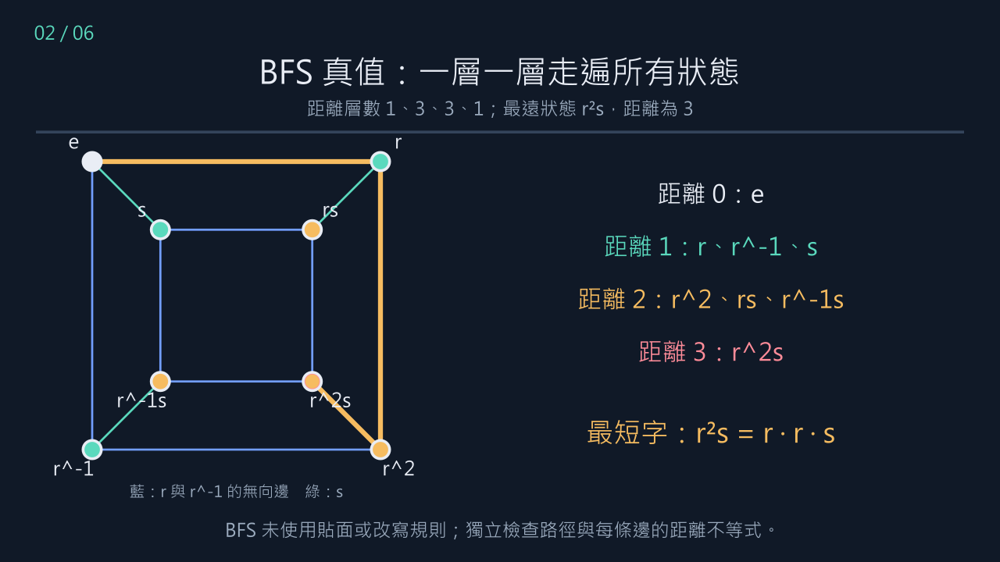
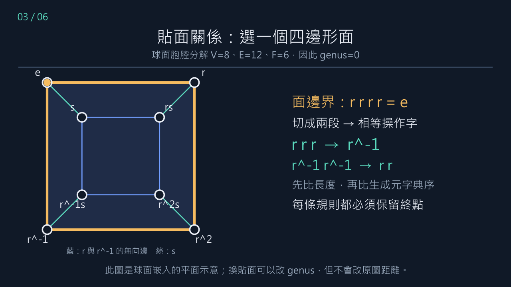
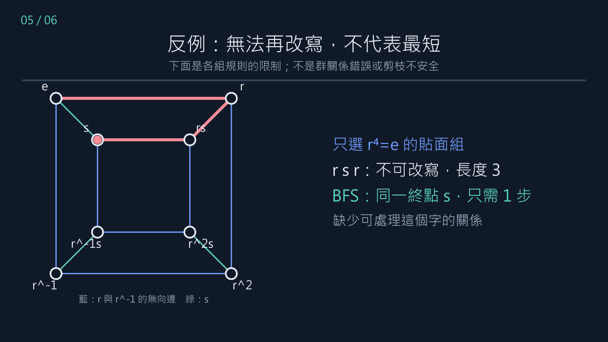

# 本週可交付：D4 的 BFS、貼面關係與安全剪枝

日期：2026-11-01。本週對應期中報告的第 1 週（10/31–11/6）。

**選用版本：Manim 本機動畫＋中文逐步講義。** 現有 `manim-scenes/.venv` 已可使用，不另建立 Colab 或訓練模型。本影片使用 Text，不需要 LaTeX；無配音，可照講義口頭說明。

## 從哪裡開始？

1. 看 [動畫 D4Pipeline.mp4](D4Pipeline.mp4)。
2. 讀 [本週一頁交付稿](teacher-brief.md)，確認與期中主線的關係。
3. 按本文件的六個步驟手算，再看 [程式產生的完整數據與搜尋 trace 表](computed-tables.md)。
4. 按最後的命令重跑；[d4_lesson_data.json](d4_lesson_data.json) 是影片使用的實際資料，不是另外捏造的動畫數字。

影片與圖片是數據的展示；正確性依據是原始輸入、檢查器、完整路徑與逐事件 trace。沒有做 Lean 形式化。

## 1．固定模型：D4 是哪一個群？

這裡 D4 指階數 8 的正方形對稱群，不是階數 4。使用

\[
D_4=\langle r,s\mid r^4=e,\ s^2=e,\ srs=r^{-1}\rangle,
\qquad S=(r,r^{-1},s).
\]

每個元素寫作 \(r^a s^b\)，以 `(a,b)` 保存，且**右乘**步行 \(x\mapsto xs\)。乘法為

\[
(a,b)(c,d)=(a+(-1)^b c\pmod 4,\ b+d\pmod 2).
\]

例如 \((1,1)(1,0)=(0,1)\)，所以 \(rsr=s\)。生成元固定順序 `r, r^-1, s`，每次成本為 1。換生成元或成本，就換了距離問題。



## 2．BFS 真值：為什麼 r²s 需要 3 步？

從單位元出發，每層只加入尚未見過的狀態：

| 距離 | 本層首次出現 | 一組最短操作字 |
|---|---|---|
| 0 | e | 空字 |
| 1 | r、r^-1、s | r；r^-1；s |
| 2 | r²、rs、r^-1s | rr；rs；r^-1s |
| 3 | r²s | rrs |

到深度 2 已完整列出可達狀態，沒有 r²s；深度 3 找到 rrs。因此它至少需要 3 步，也至多需要 3 步。8 個狀態全部覆蓋，這張小圖的直徑正好為 3。

`truth_paths` 保存每個狀態的最短字。獨立檢查器用路徑給上界，並用每條邊的距離不等式給下界；不需要信任動畫或搜尋器的 BFS 實作。

**手算驗收：**從 r^-1 出發右乘 s，會到哪裡？為什麼 r²s 不在第 2 層？

## 3．貼面與一般短關係：這次到底選了什麼？

選 registry 的 `d4-g0-squares`：V=8、E=12、F=6，χ=2、genus=0，為球面胞腔分解。實際比較採最多 1 條關係、長度上限 6、seed=0。

| 方法 | 所選額外關係 | 如何選取 |
|---|---|---|
| cancellation_only | 無 | 只保留相鄰逆操作消去 |
| ordinary | rsrs=e | 枚舉一般閉合字，配對長度預算後抽樣 |
| faces | rrrr=e | 面邊界去重，依長度與字典序選第一條 |

兩組各選一條長度 4 的關係，**不是一組拿很多資訊、另一組只拿一條**。但展開後一般組有 13 條規則、貼面組 8 條，規則總成本仍不同。

重要：`rsrs` 在這個球面分解中也恰好是一個側面的邊界。「一般」指選取方法，不表示它必須不是面。這兩個池子不是互斥類別；本例也不能用來判定「面 vs 非面」的普遍差異。



### 為什麼 rrrr=e 能變成 rrr → r^-1？

在 \(r^3r=e\) 兩邊右乘 \(r^{-1}\)，得到 \(r^3=r^{-1}\)。較長字改成較短字。另一條規則是

\[
r^{-1}r^{-1}\longrightarrow rr.
\]

兩邊長度都是 2，但在指定字母順序中 `r < r^-1 < s`，右邊字典序較小。

一般組的 \(rsrs=e\) 同樣能推出

\[
rsr\longrightarrow s.
\]

所有組共有 `r r^-1→e`、`r^-1 r→e`、`ss→e`。每條額外規則都在群的所有起點上檢查終點一致。

**手算驗收：**用 `(a,b)` 乘法驗算 rrr 與 r^-1，以及 rsr 與 s。

## 4．剪枝：不是 BFS，而是同一個 IDDFS 搜尋器

BFS 用來建立真值。比較器則使用 IDDFS：深度界依序 0、1、2、3，每輪按 `r, r^-1, s` 展開；新字尾符合規則左側就剪掉。

例如搜尋 r²s，深度界為 3 時：

| 生成候選 | 一般組 | 貼面組 |
|---|---|---|
| r | 進入 | 進入 |
| rr | 進入 | 進入 |
| rrr | 進入，到深度界就返回 | 用 rrr→r^-1 剪掉 |
| rr r^-1 | 用尾端 r r^-1 消去規則剪掉 | 同左 |
| rrs | 找到目標 | 找到目標 |

**重點：rrr 已經被產生，剪掉它不會撤銷這一次 generated 計數。** 而它已在深度界，即使進入也不會產生子節點。故本例的這次剪枝只減少 entered，不會減少後續生成量。

這不是「目前的字不可縮短，所以它一定最短」。安全性理由是：所有規則保留終點且嚴格降低 shortlex。若一個目標字典序最小的最短字含有左側，替換後會變短或同長更小，矛盾。因此每個目標至少保留一個最短代表。獨立驗證結果也確認全部小群目標距離一致。

## 5．反例：兩組各自少了什麼？

### 只選 r⁴=e 的貼面組

`rsr` 不含這組規則的左側，也沒有相鄰逆操作，因此不可再改寫。但

\[
e\xrightarrow{r}r\xrightarrow{s}rs\xrightarrow{r}s,
\qquad e\xrightarrow{s}s.
\]

同一終點有 3 步與 1 步走法。這是「不可改寫 ⇒ 最短」的反例，不是規則不合法的反例。



### 只選 rsrs=e 的一般組

`rrr` 不可改寫，但它等於一步的 `r^-1`。兩組各自捕捉了不同關係，不能把其中任一組當成完整最短字判定法。

如果同時加入兩條關係，這兩個特定反例都會被處理；仍不能因此斷言不存在其他反例或規則已合流。

**手算驗收：**指出 rsr 為什麼沒有命中「貼面組」規則，以及如何用一般組規則消去它。

## 6．為什麼現在沒有看到生成節點優勢？

針對 8 個目標加總所有 IDDFS 迭代，實際計數為：

| 方法 | generated | entered | expanded | rule_checks |
|---|---:|---:|---:|---:|
| 只消去逆操作 | 49 | 62 | 21 | 137 |
| 一般短關係 | 49 | 60 | 21 | 540 |
| 貼面關係 | 49 | 59 | 21 | 335 |

- `generated`：嘗試的子節點，含被剪掉者。
- `entered`：實際進入遞迴的節點，含每次迭代的根；所以可以大於 generated。
- `expanded`：實際嘗試產生子節點的節點。
- `rule_checks`：依目前線性掃描實作，嘗試規則比對的次數。

程式完整重播每個目標後，確認**所有額外關係剪枝都在各輪深度界**：一般組 2 次、貼面組 3 次。因此目前多剪掉的是本來就不會展開的葉節點，生成與展開數不變。

結論需要修得精確：貼面組的 entered 比一般組少 1，規則檢查也比較少；但沒有減少本例的生成／展開量。兩者的規則檢查都高於簡單基準。不能只用「49 對 49」說兩組完全等效，也不能用這個小例子推論一般時間複雜度。

另有兩項限制：D4 直徑只有 3，且字母順序讓許多最短解很早找到；這是非常小的負面對照。下一步應在較大直徑案例、不同字母順序及更多 seed 檢驗；不預設面關係一定有優勢。

## 與期中報告的銜接

原報告本週任務是鎖定範圍、整理 D4 起點、重算 Example 7，主線仍是固定三維面配對圖的拓撲與狀態資訊。本展示支援前兩項，**尚未替你完成 Example 7 或三維分類**。

本次另對 `d4-g1-hexagons` 重驗：同樣 V=8、E=12，但 F=4、χ=0、genus=1。球面與環面兩個 witness 的轉移表、全部 BFS 路徑相同；因此「改變面系統」改變曲面拓撲，但沒有改變原圖距離。這正是從期中報告走到新想法時，必須保留的界線。

三維版本的相似問題是：某種邊界摘要能否保留某個特定問題的答案？相似的是**驗證方法**，不是把 D4 規則直接當成三維演算法。不要將二維的面邊界與三維的三角形貼合映射混為一談。

## 本機重現：依序執行

以下皆從 repository 根目錄開始。第一、二步只需標準 Python；第三步使用已有的 Manim 環境。

也可一鍵重驗：`& ./cayley-thesis/reports/week1-d4-demo/run-demo.ps1`；加上 `-Render` 會重畫並更新交付影片。不自動安裝套件或更動執行政策。

```powershell
# 1. 獨立重驗原始 D4/Q8/S4 實驗
python cayley-thesis/experiments/verify_run.py cayley-thesis/experiments/results/20261031T175148_814309Z

# 2. 重建本講義數據並逐目標重播，計數必須完全吻合
python cayley-thesis/experiments/build_d4_lesson.py

# 3. 重新產生中畫質動畫與七張圖（無需自動開啟播放器）
cayley-thesis/manim-scenes/.venv/Scripts/python.exe -m manim -qm --media_dir cayley-thesis/reports/week1-d4-demo/media cayley-thesis/manim-scenes/d4_pipeline.py D4Pipeline

# 4. 另開一個新結果目錄，練習自己的 D4 實驗
python cayley-thesis/experiments/relation_search.py --groups d4 --rounds 1 --relators 1
```

第三步的重新渲染檔案在 `media/videos/d4_pipeline/720p30/D4Pipeline.mp4`；交付根目錄的影片是已渲染副本。圖中長邊線是無向 Cayley 邊，不把它當成新增的捷徑。

本次選 Manim 是為了本週穩定展示。沒有建立 Colab notebook；如果要搬到 Colab，需要另外準備 Manim 與中文字型，而不是假設本機 `.venv` 可直接移過去。

## 5 分鐘口頭順序

1. 30 秒：固定 D4、生成元、成本與右乘。
2. 45 秒：BFS 四層，為何 r²s 正好需要 3 步。
3. 60 秒：rrrr 與 rsrs；示範各一條規則。
4. 60 秒：rsr／rrr 兩個反例，各自打破什麼主張。
5. 60 秒：49、entered、rule_checks；解釋葉節點剪枝。
6. 45 秒：同骨架不同 genus，銜接「摘要對什麼問題足夠」，再回三維本週主線。

可交付清單：影片、此講義、teacher-brief、computed-tables、原始 JSON 與檢查命令。不要把本展示宣稱為 O(√N) 演算法、四階上帝之數結果或一般同胚判定器。
