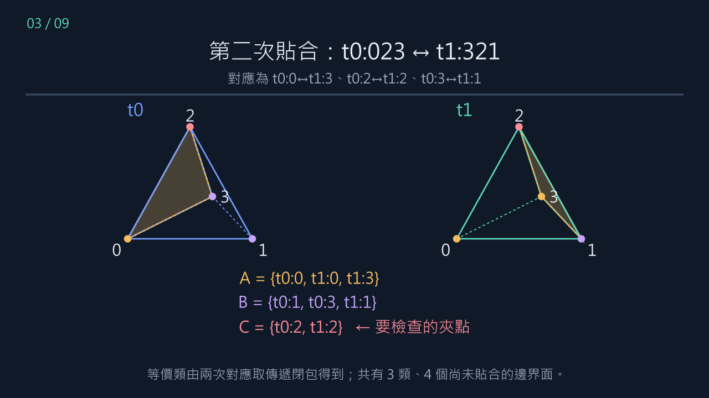
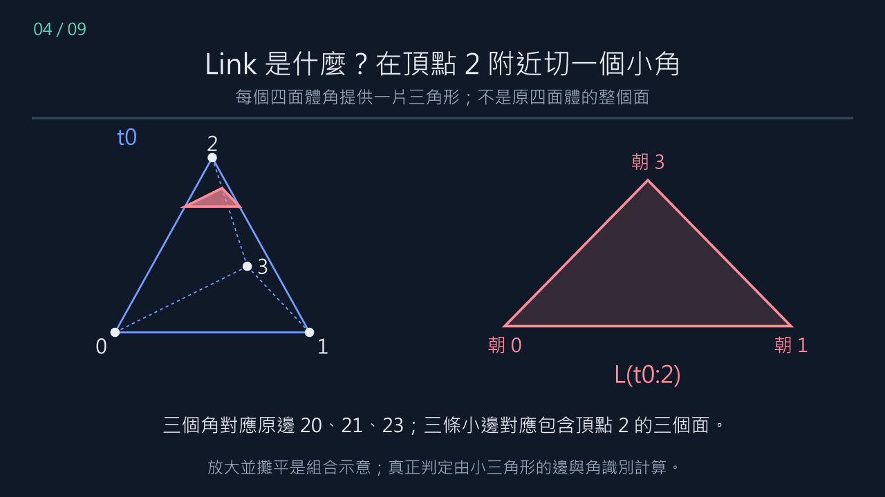
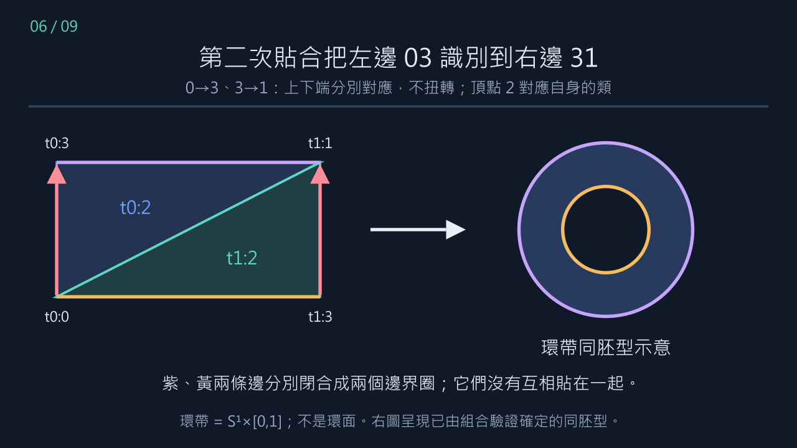

# Example 7：兩四面體、頂點等價類與環帶 link

本週教學交付，2026-11-01。延續 [D4 展示](../week1-d4-demo/README.md)，回到 [期中報告](../midterm-report-and-seven-week-plan-2026-10-30.md) 的 Example 7 驗收。

先看 [Manim 動畫](Example7Pipeline.mp4)，再按本講義手算。老師用摘要見 [teacher-brief.md](teacher-brief.md)，確切計算表見 [computed-tables.md](computed-tables.md)。影片無配音，以中文字幕與顏色逐步展示；數字直接讀取 [example7_data.json](example7_data.json)。

## 0．先處理來源：兩份輸入不能混在一起

文獻為 Burton–Pettersson，*Fixed parameter tractable algorithms in combinatorial topology*，[arXiv:1402.3876v2](https://arxiv.org/pdf/1402.3876v2)，Example 7、Figure 2、Definitions 5/6/8。原文與期中報告使用版本有一個重要差異：

| 版本 | 第一次貼合 | 第二次貼合 |
|---|---|---|
| 原文 v2 照字面 | t0:012 ↔ t1:012 | t1:023 ↔ t1:321 |
| 與原文圖表一致的推定版 | t0:012 ↔ t1:012 | t0:023 ↔ t1:321 |

本動畫主要解釋推定版；原文照字面版同時計算、保存與比較。**推定版是依 Ce/Cv 一致性做的重建，不是作者官方勘誤。** 兩份 JSON 分別是 [原文照字面輸入](input-literal-v2.json) 與 [推定輸入](input-figure-consistent-inferred.json)。

本文後續的所有 V/E/F、link、局部判定及原文照字面版差異，都是這次由明確輸入重新計算的結果，不只是轉述原文。PDF 的公式與表格經文字版本核對；線上 PDF 截圖服務未能取得圖 2，本次不宣稱已以該截圖完成目視比對。

## 1．四面體貼合究竟是什麼？

從兩個互不相交的抽象四面體 t0、t1 開始，各有頂點 0、1、2、3。

`t0:023 ↔ t1:321` 表示**依位置配對**：

- t0 的 0 對應 t1 的 3。
- t0 的 2 對應 t1 的 2。
- t0 的 3 對應 t1 的 1。

在這三個對應上唯一決定三角形面的仿射識別。不只是把兩個三角形靠近，也不能把 `321` 自動排序為 `123` 後忘掉對應；排序後仍須另外保存頂點映射。

程式內用「缺少的頂點」命名面：F0=123、F1=023、F2=013、F3=012。這只是資料格式，講義主要用三個頂點的面名。

**操作 A：**自己畫兩個四面體，先圈出 012，再圈出 t0 的 023 與 t1 的 123。說出兩次對應，不能只說「這兩個面貼起來」。

## 2．第一次貼合後：8 個頂點標記變成 5 類

第一次貼合是 012↔012，直接得到三對等價：

\[
t_0:0\sim t_1:0,\quad t_0:1\sim t_1:1,\quad t_0:2\sim t_1:2.
\]

兩個頂點 3 不在此次貼合面上，所以還沒有被識別。頂點類為：

1. `{t0:0,t1:0}`
2. `{t0:1,t1:1}`
3. `{t0:2,t1:2}`
4. `{t0:3}`
5. `{t1:3}`

邊界面由 8 個減為 6 個；此時五個頂點的 links 都是圓盤。幾何上可把它看成兩個四面體沿共同三角形組成的三維球體（3-ball）；動畫採分開畫的四面體與識別標記，以免透視圖被誤當成證明。

## 3．第二次貼合後：取傳遞閉包，得到三類

加入 `t0:023 ↔ t1:321`。將剛才的等價關係與新的三對關係合併，得到：

\[
\begin{aligned}
A&=\{t_0:0,t_1:0,t_1:3\},\\
B&=\{t_0:1,t_0:3,t_1:1\},\\
C&=\{t_0:2,t_1:2\}.
\end{aligned}
\]

例如 A 的推導是：第一次已有 t0:0∼t1:0，第二次又有 t0:0∼t1:3，因此三者在同一類。

第二次將另外兩個面配對，留下四個邊界面：

`t0:013、t0:123、t1:013、t1:023`。



**操作 B：**不看最終分組，只拿兩次貼合的六個頂點對應，用紙筆取傳遞閉包。驗收結果應為 3、3、2 個標記的三類。

## 4．Link 不是原四面體的面

在一個四面體的頂點 v 附近切掉一個很小的角，截面是一片三角形，記作 L(t:v)。這片三角形：

- 三個角分別位於從 v 出發的三條原邊上。
- 三條小邊分別位於包含 v 的三個原面上。

對頂點 2，三個小角用方向標記 0、1、3，意思是朝向原頂點 0、1、3，不是又出現三個原頂點。三條小邊可命名為 01、03、13；例如小邊 01 位於原面 012 上。

**一個頂點等價類的 link，要把該類所有四面體角的小三角形一起組裝。** 所以 C 的 link 有兩片三角形 L(t0:2)、L(t1:2)，不是一片。



## 5．環帶如何從兩片小三角形產生？

### 第一次誘導的小邊貼合

原面 012↔012 包含頂點 2，因此誘導兩個 link 的 `01↔01`。將兩片三角形沿這條小邊貼起來，可以畫成一個四邊形，以共同 01 作為對角線。

### 第二次誘導的小邊貼合

原面 `t0:023 ↔ t1:321` 中，2↔2，因此誘導：

\[
L(t_0:2)\text{ 的 }03\quad\leftrightarrow\quad L(t_1:2)\text{ 的 }31.
\]

將兩片三角形展開為下列四角，便能完全保留對應：

| 四角 | link 小角標記 |
|---|---|
| 左下 | t0 朝 0，也等於 t1 朝 0 |
| 右上 | t0 朝 1，也等於 t1 朝 1 |
| 左上 | t0 朝 3 |
| 右下 | t1 朝 3 |

第二次對應將左下貼右下、左上貼右上，所以是左右兩邊**不扭轉**地識別。上邊和下邊沒有互相識別，分別閉合成兩個邊界圈。結果是環帶（也可叫圓柱側面），不是環面。



兩個圈來自：

- 上邊：t0:123 在 L(t0:2) 中的小邊。
- 下邊：t1:023 在 L(t1:2) 中的小邊。

圖中的平滑圓環只表示同胚型；正確性依據是精確邊對應與以下檢查，不靠動畫將紙帶變形的視覺印象。

**操作 C：**剪一張有對角線的紙帶，標記四角，將左右邊按相同高度貼合。指出兩條仍存在的邊界圈。如果半扭轉後再貼，就是另一個問題。

## 6．精確計數：兩個圓盤、一個環帶

C 的 link 角等價類是：

\[
\begin{aligned}
\alpha&=\{(t_0,2,0),(t_1,2,0),(t_1,2,3)\},\\
\beta&=\{(t_0,2,1),(t_0,2,3),(t_1,2,1)\}.
\end{aligned}
\]

因此 V=2。原來共有 6 條三角形小邊，兩次各合併一對，所以 E=4；兩片三角形 F=2，故 χ=2−4+2=0。兩個未貼小邊各自成為一條只有一個角類的邊界圈；一般三角剖分容許這種商識別。

三個 links 的全部結果如下：

| 頂點類 | V | E | F | χ | 邊界圈 b | 可定向 | 類型 |
|---|---:|---:|---:|---:|---:|---|---|
| A | 5 | 7 | 3 | 1 | 1 | 是 | 圓盤 |
| B | 5 | 7 | 3 | 1 | 1 | 是 | 圓盤 |
| C | 2 | 4 | 2 | 0 | 2 | 是 | 環帶 |

使用 \(\chi=2-2g-b\) 前，程式先檢查：三角形連通、每條小邊入射數、每個 link 頂點的局部鄰域為 interval/circle、可定向性及邊界圈。這些成立後，C 有 g=0、b=2，才能以曲面分類確定為環帶。**χ=0 本身不足夠。**

## 7．為什麼環帶 link 表示不是三維流形？

在此分片線性三角剖分的框架中，內部流形頂點需要球面 link；邊界流形頂點需要圓盤 link。C 的環帶兩者都不是，所以這個底層空間不是三維流形（即使容許邊界）。

直觀上，頂點附近是 link 的錐：這裡是環帶錐，而不是三維球／半球附近的標準模型。不能因為遠看像一個圓餅就判定為流形。

論文的 **partial-3-manifold triangulation** 是較寬的演算法中間狀態：允許球面帶多個 punctures 的 links。環帶正是球面去掉兩個開圓盤，所以本推定版可以通過 Definition 5，卻不能通過真正流形的頂點 link 判準。程式也另外檢查沒有原邊被反向識別到自身。

這不是說該中間狀態永遠無法繼續完成；也不是一般同胚判定演算法。

## 8．原文照字面版提供的負面對照

照 `t1:023 ↔ t1:321` 執行，仍然是三個頂點類、四個邊界面，但內容不同：

- `{t0:0,t0:1,t1:0,t1:1,t1:3}`
- `{t0:2,t1:2}`
- `{t0:3}`

邊界面為 `t0:013、t0:023、t0:123、t1:013`，與推定版及原文 Ce 表不一致。

頂點 2 的 link 仍有 V=2、E=4、F=2、χ=0，卻是 **b=1、非可定向的莫比烏斯帶**，不是環帶；此版本也不能通過 Definition 5。

因此我們有一個實際反例：**即使頂點類總數、邊界面總數、link 的 V/E/F/χ 都相同，仍不能決定 link 的同胚型。** 可定向與邊界圈是這裡不可省略的資料。

另外要區分 `vertex_classes` 與 Cv：Cv 只保留實際出現在未貼合面上的四面體頂點標記。照字面版 t1:2 的所有相鄰面都已貼合，所以它不在 Cv 中；不能不經篩選就把全部頂點類直接當 Cv。推定版剛好所有標記都還屬於邊界面。

## 9．Ce、Cv 可以怎麼親手核對？

Cv 是前述三個邊界頂點類。六筆 Ce 全列在 [computed-tables.md](computed-tables.md)。例如：

`(t0:013,03)` 與 `(t1:013,13)` 是同一條邊的兩個邊界面出現，而且方向相反。

原因是第二次貼合把 t0 的有向邊 0→3 映成 t1 的 3→1。當兩邊局部方向都以小頂點到大頂點定向時，後者與 1→3 相反，所以 orientation indicator=False。

Ce 告訴你怎麼沿邊界小邊追蹤 link 的 punctures；Cv 告訴你哪些 punctures 屬於同一個頂點 link。本次完整重建所有 links，作為之後理解壓縮邊界狀態的基準；**尚未實作一般樹分解 DP**，也未證明 Ce/Cv 可以分類三維流形。

## 10．與 D4 驗證流程的關係

| 步驟 | D4 | Example 7 |
|---|---|---|
| 固定輸入 | 群、生成元、面系統 | 四面體、逐頂點貼合映射 |
| 建立完整基準 | BFS 所有距離與最短字 | 等價閉包、完整 link 三角剖分 |
| 局部合法性 | dart 分割、頂點 circle link | face 使用、原邊方向、頂點 surface link |
| 防止摘要誤用 | 不可改寫不代表最短 | χ=0 不代表環帶；partial 不代表流形 |
| 獨立核對 | 距離證書與路徑重播 | 另一套 signed union-find／NumPy 檢查器 |
| 保存結果 | 搜尋 trace、規則與反例 | 兩份輸入、每階段類別、Ce/Cv、局部檢查 |

二者不是同一種圖搜尋問題。共同的是：先建立可完整檢查的小例子，再研究能安全忘記什麼。D4 的 BFS 不能代替三維 link 驗證，三維的 FPT 結論也不能直接套到魔方最短解。

## 11．操作與重現

從 repository 根目錄：

```powershell
# 標準 Python：重建兩版本、三個推定階段與全部表格
python cayley-thesis/experiments/example7_rebuild.py

# 使用現有 Manim 環境（其中已有 NumPy）交叉核對另一套實作
cayley-thesis/manim-scenes/.venv/Scripts/python.exe cayley-thesis/experiments/example7_rebuild.py --cross-check

# 八項針對 Example 7 的測試
python -m unittest discover -s cayley-thesis/experiments -p test_example7_rebuild.py -v

# 重新產生 720p 動畫與九張圖
cayley-thesis/manim-scenes/.venv/Scripts/python.exe -m manim -qm --verbosity WARNING --media_dir cayley-thesis/reports/week1-example7-demo/media cayley-thesis/manim-scenes/example7_pipeline.py Example7Pipeline
```

也可執行 [run-demo.ps1](run-demo.ps1) 一鍵重算、交叉核對與測試；加 `-Render` 會重畫並更新根目錄的影片副本。不安裝套件，不自動修改執行政策。檢查時勿使用 Python `-O`，因本研究原型使用 assertions 作一致性驗收。

輸出 `example7_data.json` 保存各階段的角、邊、頂點等價類、link 小邊映射、局部檢查與邊界圈；`cross-check.json` 保存另一套實作比對結果。既有的 lens-space 程式僅以匯入方式呼叫 `analyse`，不重寫其原始結果檔。

## 12．這週怎麼向老師報告？

總計約 10–12 分鐘：

1. **2 分鐘 D4 回顧：**固定骨架不固定曲面；BFS 與改寫反例說明摘要的限制。
2. **2 分鐘貼合：**說出兩次頂點映射，從 8 類算到 5 類再到 3 類。
3. **3 分鐘 link：**切角、兩三角形、對角線、左右同向識別、兩個邊界圈。
4. **2 分鐘判準：**用完整檢查識別 disk/disk/annulus；解釋 partial 與 manifold 的差別。
5. **1–3 分鐘來源與後續：**兩份輸入、莫比烏斯帶負面對照、Ce/Cv、一套基準支援下週狀態更新。

本週現在可交付的是「Example 7 可重現重建＋D4 方法對照」。尚不包含全部四面體貼合枚舉、一般 FPT 實作、新的三維分類定理、四階上帝之數或 Lean 證明。

老師可能問的四個驗收題：

- 兩次貼合各自識別哪三對頂點？
- C 的 link 為什麼恰好兩片三角形？
- 為什麼 χ=0 還不夠，需要哪兩項額外資料？
- 為什麼符合 partial 定義，卻不是帶邊界的三維流形？
