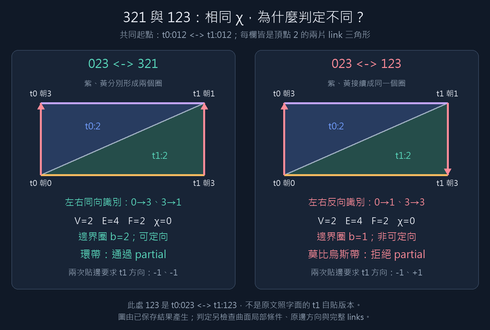

# 本週實作：Example 7 的六選一貼合

固定第一次 `t0:012↔t1:012`，第二次固定面對 `t0:023↔t1:123`，枚舉目標面頂點的六種排列。**這是指定面對的完整六種帶標記選擇，不是全部兩四面體貼合的分類。**

- [六種結果總表](summary.md)
- [321／123 的完整逐步計算、Ce、Cv 與方向證據](comparison321-123.md)
- [321／123 紙帶對照圖](comparison321-123.png)
- [最新執行目錄與結果雜湊](latest-run.json)



## 本次實際做了什麼？

1. 從共同第一次貼合保存 `before.json`：5 個頂點類、6 個邊界面、9 筆 Ce、5 個圓盤 links。
2. 依序枚舉 123、132、213、231、312、321，重建全部 links。
3. 每種選擇立即保存 `cases/<選擇>.json`：輸入、三對頂點映射、逐步等價類合併、Ce/Cv、完整角與小邊類、局部小鄰域檢查、方向、邊界圈與判定理由。
4. 對 321 與 123 額外保存兩條 link 三角形方向方程，作為可定向／方向衝突的具體證據。
5. 保存 `results.json`、`summary.csv`、`summary.md`、`comparison321-123.md`、`verification.json`。使用 `--cross-check` 時與另一套 signed union-find／NumPy 實作核對六種結果。

每次執行建立新的 UTC 時戳目錄，前次結果不覆蓋。報告資料夾中的總表與對照是最新一輪的方便閱讀副本，原始各輪都在 `experiments/results/example7-six-choice/`。

此輪是**完整重建器提供真值**。目前沒有用 Ce/Cv-only updater 作判定，沒有把時間或狀態鍵數量當成 FPT／搜尋加速的證明。

## 結果怎麼說？

- 5 種通過 partial 定義；123 因頂點 2 的 link 非可定向而拒絕。
- 只有 132、213、321 同時通過「整體可定向」的額外目標。231、312 的頂點 links 都是圓盤，但整體非可定向；不能把整體與 link 的可定向性混為一談。
- 321 有環帶 link，因此是合法 partial 中間狀態，卻不是三維流形。
- 所有結果仍有 4 個邊界面，都不是閉流形。
- 固定邊界標記後，5 個通過的 Ce/Cv 狀態鍵都不同；此輪**沒有觀察到可合併的不同狀態**，不能宣稱已示範搜尋量下降。未 quotient by relabeling。

## 用 321／123 向老師一步步解釋

### 第一步：共同起點

第一次貼合後頂點類是 `{t0:0,t1:0}`、`{t0:1,t1:1}`、`{t0:2,t1:2}`、`{t0:3}`、`{t1:3}`。

兩個選擇都保留 `2→2`，所以 link 都由 L(t0:2)、L(t1:2) 兩片小三角形組成。

### 第二步：只改第二次映射

| 選擇 | 對應 |
|---|---|
| 321 | 0→3、2→2、3→1 |
| 123 | 0→1、2→2、3→3 |

**此處 123 是 `t0:023↔t1:123`。不是先前原文照字面的 `t1:023↔t1:321`，兩份輸入不能混用。**

### 第三步：Ce 的方向不能丟

看邊界出現位置 `(t0:013,03)` 與 `(t1:013,13)`：

- 321 將 `0→3` 映成 `3→1`，相對目標局部方向 `1→3` 是反向，因此 Ce=False。
- 123 將 `0→3` 映成 `1→3`，因此 Ce=True。

其他 Ce 配對也有改變；全部六筆見生成的對照講義。只保留「哪兩條邊同一類」而忘記方向，會丟失這裡的重要資訊。

Cv 也不同。兩者雖然都有三個頂點類，321 的類大小是 3、3、2；123 是 4、2、2。頂點類總數不能代替完整分組。

### 第四步：攤開兩片 link 三角形

第一次將共同 01 小邊貼成對角線，得到紙帶。321 的第二次映射將左右兩邊同高度對應，不扭轉；123 將一側的上下端反過來對應。

| 頂點 2 的 link | 321 | 123 |
|---|---:|---:|
| V/E/F | 2/4/2 | 2/4/2 |
| χ | 0 | 0 |
| 邊界圈 | 2 | 1 |
| 可定向 | 是 | 否 |
| 曲面 | 環帶 | 莫比烏斯帶 |

### 第五步：指出明確的拒絕證據

給 t0 小三角形方向 +1。第一次小邊貼合要求 t1 方向 −1。

- 321 第二次仍要求 t1 為 −1：一致。
- 123 第二次要求 t1 為 +1：衝突，不可能為整個 link 選出一致方向。

123 的結構化拒絕碼是 `NONORIENTABLE_VERTEX_LINK`，附上頂點類、V/E/F、χ、b、方向及局部檢查。不是因 χ=0、不是因有邊界、也不是因所有邊被反向自我識別；本例的原邊方向一致性其實通過。

### 第六步：界定研究進度

「我已完成六種貼合的完整基準與拒絕證據。下一步才是只由 Ce/Cv 更新，並要求它對六種選擇的結果逐筆吻合。」

尚未實作該 updater、一般 tree-decomposition DP、同胚分類或 Lean 證明。

## 如何操作？

從 repository 根目錄：

```powershell
# 純標準 Python，建立新的一輪
python cayley-thesis/experiments/example7_six_choices.py

# 建議使用已有 NumPy 的 Manim 環境，另外交叉核對六種選擇
cayley-thesis/manim-scenes/.venv/Scripts/python.exe cayley-thesis/experiments/example7_six_choices.py --cross-check

# 檢查保存的某輪資料（代入程式印出的目錄）
python cayley-thesis/experiments/example7_six_choices.py --verify-run <結果目錄>

# 測試，包含故意破壞 Ce、判定與總數的負面案例
python -m unittest discover -s cayley-thesis/experiments -p test_example7_six_choices.py -v

# 依最新結果產生對照圖；這一步才需要 Pillow
cayley-thesis/manim-scenes/.venv/Scripts/python.exe cayley-thesis/experiments/draw_six_choice_comparison.py
```

也可執行 `& ./cayley-thesis/reports/week1-example7-six-choice/run-experiment.ps1` 一鍵完成交叉核對、測試與對照圖。此腳本使用現有 Manim 環境，不安裝套件或修改執行政策。

## JSON 要先看哪些欄位？

| 欄位 | 用途 |
|---|---|
| `glues`、`vertex_map` | 確認究竟貼了什麼 |
| `vertex_merge_trace` | 三個頂點對應如何改變等價類 |
| `after.Ce`、`after.Cv` | 最終邊界狀態 |
| `after.links` | 完整 link 基準與局部檢查 |
| `decision.link_checks` | 每個 link 哪一項通過／不通過 |
| `decision.rejection_reasons` | 結構化拒絕原因與證據 |
| `decision.orientable_partial_accepted` | 額外要求整體可定向後的判定 |
| `apex_orientation_trace` | 321／123 的兩次方向方程 |
| `boundary_state` | 固定標記下的 Ce/Cv 鍵，僅供後續狀態合併準備 |

獨立實作比對的範圍在 `cross_check.scope` 中說明。它交叉核對 Ce/Cv、局部曲面、V/E/F、χ、b、整體方向與原邊一致性；不是形式化證明，也不是由壓縮狀態推導的新結果。
